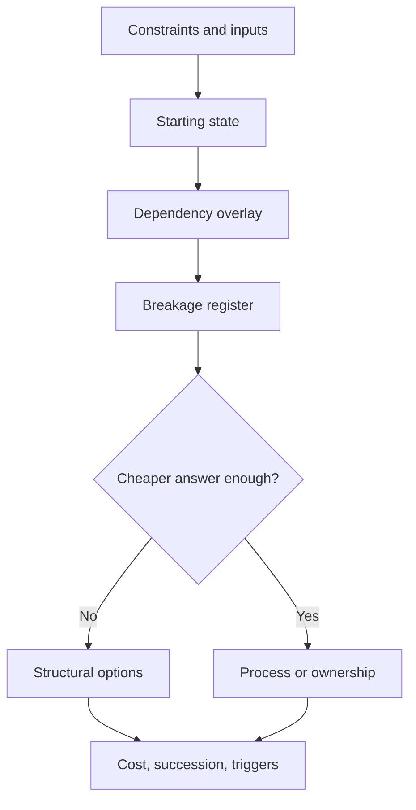

# Project 4: Redesign an Organization of 80 Engineers

It is week 44 of your first year as Engineering Director at Northstar Technologies, the fictional
company of the [case study](../case-studies/northstar/index.md). The quality transformation has been
running for three quarters. Victor Lindqvist, the CTO, has asked you for a year-2 organization
proposal, effective at the start of quarter 5 (week 53). He will decide. Your job in this project is
to produce that proposal: a design that fits Northstar's architecture, products, and fixed headcount,
with its alternatives, its arithmetic, its transition cost, and the evidence that would show it
worked.

The project applies [Chapter 33](../parts/07-organization-design/33-conways-law-team-topologies-and-cognitive-load.md),
[Chapter 34](../parts/07-organization-design/34-spans-layers-and-dependency-mapping.md),
[Chapter 35](../parts/07-organization-design/35-designing-organizations-at-four-scales.md), and
[Chapter 36](../parts/07-organization-design/36-reorganizations-evolution-and-succession.md). It
takes about 12 to 20 hours.

## Problem Statement

Northstar's engineering organization was not designed; it accumulated. In the baseline quarter, items
with no cross-team dependency took a median of 11 days, items with one took 24, and items with two or
more took 41. Three Core modules changed by four teams had no owner, and three staff engineers had
titles without mandates. The first quarter fixed some of this by decision (owners for core/customer,
core/scheduler, auth-svc, and webhooks; the QA engineers moved into product teams), and quarter 2 added
a Billing-owned order-to-invoice contract. The structure itself has not changed.

By week 44 the strain shows in specific places. One manager has 17 reports across two sites and two
products. A first-year manager has 16 reports and seven components. A tier 1 module still has no
owner. A five-person platform team still works largely as a ticket queue. Ten roles are critical,
and none has a successor ready now.

Your task is to propose the year-2 organization under the flat-headcount rule: 87 people in total,
and any new manager taken from an engineering seat that is not backfilled.

Chapter 35 tells one version: the director's week-44 proposal (split Customer Experience into Web and
Mobile, move core/permissions to Orders and search-svc to Data and Analytics, rename Platform
Operations as Developer Platform) with three alternatives, B, C, and D. That proposal is one worked
answer, not the answer. You may arrive at it, improve it, or reject it. Whatever you propose, you must
evaluate at least two of the chapter's alternatives honestly, including the strongest case for each.

## Scenario and Constraints

**Your position.** Engineering Director, with nine direct reports (six managers, three staff
engineers). You design the organization and the transition plan. Victor
Lindqvist decides the design and any engineering seat converted into a management seat. Amara Okafor
(CPO) cares about which teams serve which product outcomes. Rajiv Menon (CFO) holds the headcount line.

**Timing.** You submit in week 44. Victor decides in week 46. Reporting lines change in week 53. Your
proposal must work with a quarter of preparation and a quarter of settling.

**Constraints.** These are binding.

1. **Flat headcount.** The whole engineering organization is 87 people: 80 engineers, 6 managers,
   the director. Backfills are allowed; net additions are not. Promoting an engineer into a new manager
   role is allowed only if that engineer's seat is not backfilled. No external hire for a new role.
2. **No Core rewrite.** The Core monolith keeps its shape; module boundaries can be enforced in the
   build, not redrawn as services.
3. **Every component has exactly one owning team** at the end of the transition, including the two
   that have none today.
4. **No pay or level changes** as part of the reorganization; promotions run through the normal
   calibrated cycle.
5. **Ownership standards.** Tier 1 components must reach the four operational minimums (owner,
   complete user-facing alerts, runbook, on-call); exemptions expire after at most two quarters.

## Starting Dataset

Use these sources:

- [Northstar overview](../case-studies/northstar/index.md), [baseline data](../case-studies/northstar/baseline-data.md),
  and [the first quarter](../case-studies/northstar/first-quarter.md), including the decisions that
  hold, the day-90 results, and the starting points for quarter 2.
- [`components.csv`](../case-studies/northstar/data/components.csv) for tier and baseline readiness;
  [`teams.csv`](../case-studies/northstar/data/teams.csv) and
  [`incidents-last-quarter.csv`](../case-studies/northstar/data/incidents-last-quarter.csv) for the
  baseline picture.
- The analyses in Chapters 33 and 34 (Orders' cognitive load, spans, the classified dependency links,
  the candidate moves M1 to M3) and the week-44 succession table in Chapter 36.

**Project data: the week-44 roster.** [`p4-week44-roster.csv`](data/p4-week44-roster.csv) lists each
team at week 44 with its manager, engineers by location, composition, and components owned. It is
**derived from the canon**, not new: the baseline roster and locations, plus the quarter 1 and quarter
2 ownership moves and the seven QA engineers' placement in week 10. Check: 16 + 15 + 13 + 17 + 11 + 5 +
3 = 80 engineers; 52 in Minneapolis, 16 in Bogotá, 12 remote. Its last row lists the two components
with no owner: core/permissions (exemption lapsed at week 39) and document-store (orphaned since baseline).

**Facts your submission must use.**

| Area | Facts |
|---|---|
| People and spans | Spans 16, 15, 13, 17, 11, 5; director with 9 direct reports; 87 people; Priya Raman in her first year as manager; Mateo Arango Ríos doing lead work unrecognized for over a year; Hannah Lindgren the informal web lead |
| Customer Experience | 9 web, 6 mobile (all in Bogotá), 2 quality engineers; one board and sprint; health check in week 16 with mobile red on 4 of 10 indicators; two of four baseline Sev2 incidents at the mobile-bff and mobile boundary |
| Dependencies | 86 links by pair in the baseline quarter; the five heaviest classified by cause (Chapter 34); lead time by number of dependencies; Orders, Billing, and Payments exchanging 27 links among themselves and 48 with the other three teams |
| Architecture | Co-change pairs (order-capture and pricing-rules 53 percent of pricing-rules' 110 merge requests); core/permissions changed by 38 merge requests, 17 from Orders; Orders knowledge map in week 14; document-store's two callers |
| Orders load | Seven components across six domains; about 2.6 engineers left for everything else in quarter 2 while bulk ordering ran |
| Platform | Five engineers; two-person interrupt rotation; other teams' requests down from 20 to 14 points of capacity by week 18; four CI systems costing about 1.5 FTE a year against about 0.5 for one |
| Data and Analytics | 12 points of capacity on other teams' requests at baseline; Farah Haddad also the team's data architect; search-svc's authors on the team |
| Succession | 10 critical roles; none ready now; 6 with interim cover; 4 with none |
| Money | $185,000 per engineer-year; 13-week quarters; 80 × 13 = 1,040 engineer-weeks a quarter |

**Facts you do not have.** The canon leaves these open, and your proposal must treat each as an input
with branches, not assume an answer: whether Victor Lindqvist will release an engineering seat for a
seventh manager; whether Mateo wants the manager role; Rafael Duarte's choice between management and
the staff track (Chapter 4); the outcome of Tomasz Wierzbicki's outside offer (week 20); whether the
order-to-invoice contract has shortened Orders and Billing waits; how Customer Experience's links split
between web and mobile (the matrix counted one team); and quarter 2 and 3 incident and delivery
results beyond what the canon states. State any assumption you make about the renewals having shipped.

## Required Deliverables

One proposal document of no more than about 12 pages, plus your spreadsheet.

1. **Breakage register.** Each breakage you will address, with its evidence, the cheaper non-structural
   answer you tested first (process, decision rights, ownership, a tech lead), and why it is or is not
   enough. Include at least one breakage you decided not to address and why.
2. **Options.** A do-nothing baseline and at least three designs, one of them your recommendation. For
   each: every team with manager, engineer count, and mission; the arithmetic showing 87 people; spans;
   the director's direct reports; engineering seats converted; people who change manager; components
   that change owner.
3. **Ownership table.** Every component in the roster file, assigned to exactly one team under your
   recommendation, with tier.
4. **Dependency overlay.** For each option, which baseline links stay inside a team, which cross, which
   new boundaries are created, and which links you cannot count. Use Chapter 34's method.
5. **Roles.** One-paragraph mandates for the three staff engineers; a product statement for the
   platform team; for any new manager, who develops them.
6. **Transition cost and plan.** An estimate in engineer-weeks using Chapter 36's method, with
   assumptions; a week-by-week plan from decision to 90-day review; what does not change.
7. **Succession impact.** The week-44 coverage table redone for your design: which gaps it closes,
   which it opens.
8. **Decisions, inputs, triggers.** The decisions your design makes, the inputs it depends on with a
   branch for each, the evidence that will show it worked after two quarters, and the triggers for the
   next structural change.
9. **A one-page memo to Victor Lindqvist** with the recommendation, the costs, and the decision you
   need from him by week 46.

## Step-by-Step Instructions

1. **Write down the constraints and the inputs you do not control** before drafting any chart (Chapter
   35, playbook step 1).
2. **Rebuild the starting state.** From the roster file, list spans, components per team, and
   locations. Recompute the totals. Mark which managers are above the span range Chapter 34 would set
   for them and why (first-year manager, two sites, a manager who still holds a technical role).
3. **Overlay the dependency links** on today's boundaries. Use the pair counts in the baseline page and
   the five classified links in Chapter 34. Separate links that are a self-service problem (environment
   and pipeline requests) from links that are a boundary problem.
4. **Name the breakages** with evidence. For each, apply Chapter 35's symptom table and the sequencing
   questions: is the same work done twice, are technical decisions unowned, are managers undeveloped,
   or is it a process problem.
5. **Test the cheaper answer first** for every breakage. A tech lead, a contract, a decision record, or
   an ownership assignment may remove the need to move anyone.
6. **Draft boundaries along coupling,** then check them against product outcomes and locations. Use the
   co-change data: a boundary that cuts a pair of modules changed together in half of their merge
   requests is expensive.
7. **Write the options** with complete arithmetic. Every option must place 80 engineers or fewer plus
   managers so that the total is 87.
8. **Score each option** against spans, links, seats, people moved, and succession. Write the strongest
   case for the options you reject.
9. **Estimate transition cost** for at least your recommendation and one alternative, part by part
   (ramp-up, handoff, management), and compare it with the benefit you expect, stated as a forecast.
10. **Redo the succession table** for the recommended design (Chapter 36).
11. **Separate decisions from inputs,** and write the branch for each input you do not control.
12. **Name the evidence and triggers.** What you will measure at the week 64 review and after two
    quarters, and what would cause you to propose the next change.
13. **Check every total twice,** by team and by role.

The diagram is the order of reasoning. Most breakages should exit at the cheaper-answer test; only the
ones that do not should become structure.

## Explicit Trade-offs

| Trade-off | The tension at Northstar |
|---|---|
| A seat for a manager | Each new manager costs an engineering seat, about $185,000 a year of capacity, in a year when unplanned work is still being paid down |
| Span against layer | Fixing every span above range needs about eight managers for 77 people, and a director with eight managers plus three staff engineers is the layer question by another route |
| Split Customer Experience, or keep it whole with subteams | A split answers two products, two sites, and the red health signals; subteams cost no seat and are easier to reverse |
| Split Orders now or later | A split fixes the second-highest span and halves Orders' domains; it creates a boundary inside the most-coupled part of Core and comes right after bulk ordering |
| Grow the platform team | Measured waste (about 1 FTE a year in redundant CI) argues for more platform capacity; under flat headcount every transfer leaves a stream-aligned team |
| Who takes core/permissions | Orders changes it most (17 of 38) and Priya Raman accepted it after week 26; the other 21 merge requests will now wait on Orders' reviewers |
| Manager of managers | A layer settles Orders and Billing friction one level down and adds a hop to the 48 links between the order-to-cash teams and the rest; two leads would be new to the job |
| Stability against fit | Every change costs weeks of context; a slightly wrong structure that holds for two years can beat a better one changed twice |

## Acceptance Criteria

A submission is accepted only if all of these hold.

1. Every option's arithmetic totals 87 people, with engineers, managers, and the director stated
   separately, and seats converted to management stated.
2. Under the recommendation, every component in the roster file, including core/permissions and
   document-store, has exactly one owning team.
3. A do-nothing baseline is included and evaluated, including what happens under it to
   core/permissions, whose exemption lapsed at week 39.
4. At least two of Chapter 35's alternatives B, C, and D are evaluated with their strongest case.
5. The dependency overlay is done for at least the recommendation and one alternative, and names the
   links that cannot be counted.
6. A transition-cost estimate exists for the recommendation, with every assumption stated.
7. The succession table is redone for the recommendation.
8. Each input from "Facts you do not have" that affects the design has a branch.
9. Evidence for the two-quarter review and triggers for the next change are stated.
10. No fact is invented about the canon; assumptions are labeled as assumptions.

## Evaluation Rubric

Weights total 100. A strong pass is 75 or more with no criterion weak.

| Criterion | Weight | Excellent | Adequate | Weak |
|---|---|---|---|---|
| Breakages and cheaper answers | 15 | Each structural change answers a named breakage with evidence; cheaper answers tested and the reason they fall short stated; at least one breakage deliberately left alone | Breakages named with evidence; cheaper answers mentioned | Structure justified by headcount ("we are 80, so we need groups") or by a famous company's model |
| Arithmetic and completeness | 15 | All options add to 87, checked by team and by role; spans and director reports shown; every component placed once | Totals correct for the recommendation; minor gaps elsewhere | Totals wrong or missing; a component left unowned; seats appear from nowhere |
| Architecture and dependency fit | 15 | Overlay counted per option; co-change and knowledge data used to place seams; unmeasured links named as risks | Overlay for the recommendation; co-change mentioned | Boundaries drawn without reference to links or coupling |
| Options and honest evaluation | 20 | Do-nothing plus three designs; the strongest case for each rejected option; Chapter 35's proposal treated as an answer to test, with its weaknesses named | Options present; rejected ones dismissed briefly | One design; alternatives are straw men; the canon proposal copied without evaluation |
| Transition cost and plan | 10 | Part-by-part estimate, compared across options and against a forecast benefit; plan sequences announcement, rotations, and readiness checks; states what does not change | Estimate for the recommendation; plausible plan | No cost, or "minimal disruption" asserted |
| People | 15 | Succession redone; new managers have a developer and a cover; staff mandates with decision scope; the site, on-call, and career effects on named people considered | Mandates and succession present | People absent from the design, or moved without regard to knowledge and rotations |
| Decisions, inputs, triggers | 10 | Every open input branched; evidence and thresholds for the two-quarter review; triggers for C and D named | Some branches and triggers | Assumes Victor's and others' decisions; no way to tell whether the design worked |

## Solution

The worked solution, with the options recomputed and an evaluation of Chapter 35's proposal, is in
[Project 4 solution](solutions/p4-solution.md).
