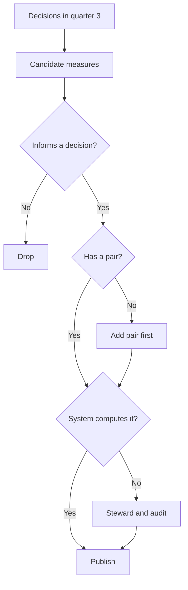

# Project 5: Build a Delivery Performance and Reliability Scorecard

!!! warning "Awaiting human review"
    This project has passed the book's automated validation and an editorial self-review, but not yet
    the human review in which each cited claim is checked against its source. Treat it as a reviewed
    draft. Corrections are welcome; see the repository's CONTRIBUTING file.

It is weeks 25 and 26, the end of quarter 2 of your first year as Engineering Director at Northstar
Technologies, the fictional company of the [case study](../case-studies/northstar/index.md). You are
planning quarter 3 (weeks 27 to 39). The allocation is drafted: unplanned work as a measured tax,
prevention stepping down from 12 FTE to 8, a platform line, and product work committed to the cautious
case. Victor Lindqvist (CTO) will sign the plan, and he wants to see each quarter whether the spending
bought what it promised. Your job in this project is to build the organization scorecard that answers
that question for quarter 3: the measures, their definitions and sources, their pairs, their owners,
and an honest reading of where Northstar stands.

The project applies [Chapter 38](../parts/08-management-operating-system/38-scorecards-quarterly-planning-and-capacity-allocation.md),
with [Chapter 18](../parts/04-execution/18-measuring-engineering-productivity.md) for delivery measures
and their gaming, [Chapter 24](../parts/05-engineering-quality/24-reliability-slos-and-operational-readiness.md)
for SLOs and error budgets, [Chapter 27](../parts/05-engineering-quality/27-quality-transformation-at-enterprise-scale.md)
for the quality scorecard, and the [engineering quality scorecard template](../templates/engineering-quality-scorecard.md).
It takes about 12 to 18 hours.

## Problem Statement

Northstar measures more than it did. At baseline the only engineering figures in the CEO's board pack
were committed roadmap items delivered and the Sev1 and Sev2 count, and delivery numbers came from one
engineer joining four CI systems' logs by hand for two days a month. By week 26 there are SLOs in
reporting mode, a severity definition with a weekly audit, a quality scorecard reviewed monthly per
team, corrective actions with manager owners, and a decision log. There is not yet one scorecard that
tells the director, the CTO, and through them the CEO and the board, whether the organization is
getting more reliable and delivering more predictably, and whether the capacity split is paying for
that.

The numbers also disagree in ways a scorecard must handle. Availability on the contractual paths was
99.86 percent in quarter 2, still below the 99.9 percent in the contracts, while Sev1 and Sev2
incidents fell from 30 at baseline to 17. Core's change failure rate has been flat for two quarters (22
then 23 percent). Several numbers rest on human classification, the availability probe runs from one
region and does not see the mobile path, and the invoice correctness SLO has no data. Rajiv Menon (CFO)
asked at the start of quarter 2 for an output-per-engineer figure by team for the budget pack, with
Helena Marsh's (CEO) support; that request is still open.

Your task is to build the quarter 3 organization scorecard: about ten entries, each with a pair, an
owner, a separate data steward, a definition two people would compute the same way, a source, and the
decision it informs, plus a reading of the baseline, quarter 1, and quarter 2 values with their
uncertainty.

[Chapter 38's case study](../parts/08-management-operating-system/38-scorecards-quarterly-planning-and-capacity-allocation.md#case-study)
gives one version: an eight-entry scorecard proposed by the director in week 26. That proposal is one
worked answer, not the answer. You may adopt it, improve it, or replace it, but you must evaluate it
against the chapter's own rules.

## Scenario and Constraints

**Your position.** Engineering Director. You own the organization scorecard. Victor Lindqvist approves
it with the quarter 3 plan. Kwame Mensah (staff engineer, operational minimums and pipelines), Li Na
Zhou (data, migration, and configuration), and Tom Becker's Platform Operations team hold most of the
data. Amara Okafor (CPO) and Rajiv Menon read it.

**The time rule.** Use facts dated week 26 or earlier, including the quarter 2 results and the
director's week-26 report (Chapter 39). Anything that happens in quarter 3 is off limits.

**Constraints.** These are binding.

1. **About ten entries.** No more than ten, with Chapter 27's quality block counted as one entry. You
   must list exactly which quality rows the block contains.
2. **Every entry has a pair,** a row owner who explains its movement, and a data steward who owns the
   definition and the pipeline. Nobody is steward of a row that measures their own team's results.
3. **Team and system level only.** No per-engineer measure, and no table that ranks teams against each
   other.
4. **Directions, not targets,** except where someone has a legitimate reason to set a target. State the
   reason for every target.
5. **Data you can actually get by week 39.** The shared deployment-event store (about six engineer-weeks
   in the platform roadmap) is not yet running. Any other new data source must be costed in
   engineer-weeks and paid from the prevention or platform line.
6. **Open decisions stay open.** The error budget policy (reporting mode, or enforced with Victor
   Lindqvist arbitrating) is his decision; the scorecard must work under either. Rajiv Menon's request
   is answered with a recommendation, not settled.

## Starting Dataset

Use these sources:

- [Baseline data](../case-studies/northstar/baseline-data.md), including how the numbers were
  produced and their known weaknesses, and [the first quarter](../case-studies/northstar/first-quarter.md),
  including the day-90 results and the quarter 2 results table.
- [`teams.csv`](../case-studies/northstar/data/teams.csv) for baseline delivery by team,
  [`components.csv`](../case-studies/northstar/data/components.csv) for tiers, and
  [`incidents-last-quarter.csv`](../case-studies/northstar/data/incidents-last-quarter.csv) for the
  baseline incidents.
- Chapter 18's measurement set and gaming table, Chapter 24's SLO design, Chapter 27's scorecard rules
  and the template's example rows, Chapter 38's capacity cases and proposed scorecard, and Chapter 39's
  week-26 report.

**Project data: the quarterly readings.** [`p5-quarterly-readings.csv`](data/p5-quarterly-readings.csv)
gathers every measure the canon reports for the baseline quarter, quarter 1, and quarter 2, with
numerators and denominators where the canon gives them and a note where it does not. It is **derived
from the canon**, not new. Blank cells mean the canon does not record the value; do not fill them with
estimates presented as readings.

**Facts your submission must use.**

| Area | Facts |
|---|---|
| Reliability | 99.62 percent availability at baseline and 99.86 in quarter 2 against 99.9 by contract; service credits $410,000 and $95,000; synthetic checks from one region, mobile path not covered |
| SLOs | Order submission 99.9 percent, order latency 99 percent within 2 seconds, payment final within 60 seconds 99.9 percent, invoice correctness 99.99 once reconciliation exists; about 600,000 order submissions and 240,000 payment attempts per 28 days; budgets in reporting mode, any incident consuming more than a fifth of a journey's budget gets a tracked review |
| Incidents | 30, 21, 17 Sev1 and Sev2; via Core releases 9, 4, 2; recurrences 11, 5, 3; customer-detected 47, 29, 29 percent; 8 of the 14 baseline customer-detected incidents were correctness failures |
| Delivery | Core releases 2 a month at baseline, 11 in quarter 1, 13 in quarter 2; Core change failure rate 31% (4 of 13 releases over the 26 weeks before arrival), 22% (2 of 9 weekly releases from week 5), 23% (3 of 13); Core lead time 19 days and services 3 at baseline; review wait 21 working hours; 74-minute pipeline |
| Readiness and follow-through | Tier 1 at the four minimums 3, 8, 11 of 15 (year-1 counts keep the original list of 15 for comparability, although notification-svc moved to tier 2 from quarter 2; year 2 uses the current list of 14); corrective-action closure 32, 70, 78 percent |
| Capacity | Unplanned work 34, 31, 28 percent; quarter 3 planned case 22 percent (17.6 FTE), cautious case 28 percent (22.4 FTE); prevention 8 FTE; platform 4.5 FTE; the week-31 trigger in Chapter 38 |
| Friction | Environment waits about 6 days to 2 and other teams' requests 20 to 14 points by week 18 |
| Measurement | Change failure rate linked by hand under a 72-hour rule; four shell-script services log nothing; unplanned work sampled for two weeks per team; severity assigned by on-call with a weekly audit since week 7 |
| Money | $185,000 per engineer-year; 80 engineers |

**Facts you do not have.** Whether the invoice reconciliation job is running and producing data;
quarter 1 availability and credits; any Core lead time, time to restore, or committed-delivery figure
after the baseline quarter; whether the developer survey the director proposed in Chapter 18 has been
run; whether the fortnightly Core releases of weeks 1 to 4 failed (quarter 1's change failure rate
counts only the 9 weekly releases from week 5); and whether Victor will choose policy A or B.
Treat each as a data gap with an action, not a value.

## Required Deliverables

One scorecard document of no more than about 10 pages, plus your spreadsheet.

1. **Decision map.** The decisions in quarter 3 the scorecard must inform, who owns each, and when it
   is made (for example the week-31 prevention trigger, the week-32 Core change failure checkpoint in
   the week-26 report, the quarter 4 allocation, renewal conversations, the error budget policy).
2. **The scorecard.** No more than ten entries. For each: definition with numerator and denominator,
   source, baseline, quarter 1 and quarter 2 readings with counts, direction or target (with reason),
   pair, row owner, data steward, gaming risk and audit, the decision it informs, and data status
   (system-generated, hand-joined, sampled, or not yet available).
3. **The quality block,** listed row by row by reference to the template, with any row you lift out of
   it into its own entry and why.
4. **Reliability section.** Each SLO journey with its 28-day budget in events and minutes; how
   contractual availability and the SLOs relate; what the scorecard does about invoice correctness
   and the mobile path while they are unmeasured.
5. **Readings with uncertainty.** Recompute every quarter 2 value from its counts. For small counts,
   state an interval or say why the change cannot be distinguished from noise.
6. **Data quality register.** For every entry: how the number is produced, its known weakness, the
   audit, and the action and cost to improve it.
7. **Executive view.** The four or five numbers you would lift for Victor Lindqvist and the board, and
   why those.
8. **A one-page reply to Rajiv Menon** on output per engineer.
9. **Evaluation of Chapter 38's eight-entry scorecard** against the chapter's rules.

## Step-by-Step Instructions

1. **Start from decisions, not measures.** List the decisions quarter 3 holds and who owns them. A
   measure that informs none of them does not go on the scorecard.
2. **Rebuild the readings.** Open the CSV, recompute each quarter 2 percentage from its counts, and mark
   every figure that has no count behind it.
3. **Draft candidate measures** for each area of Chapter 38's table: outcomes, quality, delivery,
   commitments and investment, people.
4. **Apply the three tests** to each candidate: does it change a decision someone owns, does it have a
   pair, can a system compute it? Cut, pair, or assign a steward and an audit.
5. **Define the quality block** by reference to the template and Chapter 27. Check for any measure that
   appears both inside the block and as a separate entry; a measure in two places can end up with two
   definitions.
6. **Write definitions** precise enough that two people compute the same number. For change failure
   rate, say whether you use Northstar's 72-hour rule or DORA's definition (Chapter 18), and how long
   you show both.
7. **Assign owners and stewards,** and check the separation rule.
8. **Read the quarter honestly.** Incidents are rare events; a fall from 21 to 17 is weak evidence on
   its own. Mechanism measures built from many events (releases, pipeline runs, budget consumption)
   carry more.
9. **Write the executive view and the reply to Rajiv,** then the evaluation of Chapter 38's proposal.
10. **Check every number twice,** from counts and from the percentages the canon reports.

The diagram is Chapter 38's three tests in order. Most candidates leave at the first test.

## Explicit Trade-offs

| Trade-off | The tension at Northstar |
|---|---|
| Fewer rows against coverage | Ten entries cannot show everything; every row added makes every other row less read |
| Contractual availability against SLOs | The contract measures a one-region probe per quarter; the SLOs measure what users experience over 28 days; reporting both invites the question which one is true |
| Change failure rate definitions | The 72-hour rule gives continuity with the baseline; DORA's definition gives comparability; showing both doubles the explanation |
| Incident counts against mechanism measures | The board understands Sev1 and Sev2 counts; counts of 17 move by several with no change in the rate |
| Targets against directions | A target on incidents (Victor's "below 10" in Chapter 38) focuses attention and invites downgrading |
| Correctness | 8 of 14 baseline customer-detected incidents were wrong amounts or data, several of them invoices; invoice correctness has no data, and a row with no data is honest and looks empty |
| Building the event store against the platform roadmap | About six engineer-weeks ends the hand join; it competes with self-service environments and CI consolidation for the same 4.5 FTE |
| Saying no to Rajiv | Refusing output per engineer protects the instrument; Rajiv's real question, whether the money goes to the right places, still needs an answer |

## Acceptance Criteria

A submission is accepted only if all of these hold.

1. The scorecard has no more than ten entries, the quality block counts as one, and its rows are
   listed.
2. Every entry has a written definition, a source, a pair, a row owner, a data steward, and the
   decision it informs; no steward measures their own team's results.
3. No entry is per engineer, and no entry ranks teams.
4. Every target has a stated reason; every other row carries a direction.
5. Every quarter 2 reading is recomputed from counts where the canon gives counts, and the values the
   canon does not record are left blank with an action, not estimated.
6. Each SLO's 28-day budget is computed, and invoice correctness and the mobile path are addressed.
7. At least the incident count and Core change failure rate are read with their uncertainty.
8. The scorecard works under both error budget policies.
9. The reply to Rajiv Menon answers his underlying question.
10. No fact is invented about the canon; assumptions are labeled as assumptions.

## Evaluation Rubric

Weights total 100. A strong pass is 75 or more with no criterion weak.

| Criterion | Weight | Excellent | Adequate | Weak |
|---|---|---|---|---|
| Decision linkage | 15 | Every entry tied to a named decision, owner, and date; rows that inform nothing removed with a reason | Most entries tied to decisions | Measures chosen because they exist or are familiar |
| Definitions and data quality | 20 | Numerator, denominator, window, source, and known weakness for every entry; data status and audit stated; gaps costed | Definitions and sources for most entries | Labels without definitions; hand-joined and sampled figures presented as system data |
| Pairing and gaming | 15 | Every pair exposes a named gaming route; classification measures audited; no measure appears twice with two definitions | Pairs present; gaming mentioned | Unpaired rows; targets on mechanism measures |
| Reliability coverage | 15 | Contract, SLOs, budgets, and correctness reconciled; blind spots (mobile path, invoice correctness) named with an action; works under both budget policies | Availability and SLOs present | Availability alone; blind spots ignored |
| Readings and uncertainty | 15 | Every value recomputed from counts; intervals for small counts; flat and worsening rows shown; differing windows and denominators flagged | Values correct; uncertainty mentioned | Percentages copied; improvement claimed from small counts |
| Ownership and governance | 10 | Owner and steward separated; change control on definitions; removal rule and review cadence | Owners named | No owners, or owners who can redefine their own numbers |
| Executive view and Rajiv | 10 | Four or five lifted numbers with reasons; a reply that declines per-engineer output and answers the investment question with figures | A reply that declines politely | Per-engineer figures produced, or a refusal with no alternative |

## Solution

The worked solution, with every reading recomputed and an evaluation of Chapter 38's proposal, is in
[Project 5 solution](solutions/p5-solution.md).
