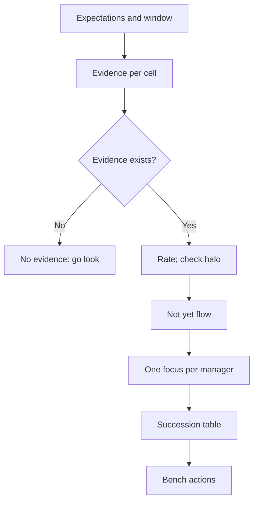

# Project 6: Create Engineering Manager Development and Succession Plans

It is week 24, near the end of quarter 2 of your first year as Engineering Director at Northstar
Technologies, the fictional company of the [case study](../case-studies/northstar/index.md). For the
first time, you are going to assess the six engineering managers who report to you, agree a
development plan with each, and write down who could step into each critical role if its holder left
next week. You draft in week 24, hold the conversations in weeks 25 and 26, and finalize in week 27,
the first week of quarter 3. Your job in this project is to produce those documents: an evidence-based
assessment of each manager, six one-quarter development plans, and a succession table for the
organization's critical roles, with the actions that would close its gaps.

The project applies [Chapter 41](../parts/09-engineering-directorship/41-managing-and-developing-engineering-managers.md)
and the [Engineering Manager performance rubric](../templates/engineering-manager-rubric.md), with
[Chapter 36](../parts/07-organization-design/36-reorganizations-evolution-and-succession.md#succession-coverage)
for the succession table, readiness scale, and coverage rule, and
[Chapter 40](../parts/09-engineering-directorship/40-the-directors-job.md#building-your-own-signal-sources)
for skip-levels. It takes about 12 to 18 hours.

## Problem Statement

At baseline Northstar's managers were reviewed once a year on their teams' roadmap delivery alone,
against a one-line job description: "lead a team of engineers to deliver high-quality software". On
that basis the manager whose team deployed most looked strongest, and nothing measured showed that his
mobile engineers felt unheard. The director has since stated expectations in pieces (a time cap for
one manager, tier 1 minimums, incident commander training, manager ownership of corrective actions)
and, in week 22, wrote a one-page expectation on the rubric's six dimensions.

The director's signal is thin. There were no skip-levels in weeks 1 to 15; individual skip-levels
started in week 16, four a week, and no group skip-level has been held. The director's firsthand time
was measured at 4.7 percent of their hours in weeks 14 and 15.

Succession is thinner. Every one of the six managers is a single point of failure, and under the
flat-headcount rule a new manager can only come from an engineering seat that is not backfilled. The
bench is built from current engineers or not at all. Several people who might cover a role already
hold another critical role, or would cover several.

Your task is to assess each manager on the six dimensions with dated, observable evidence, write a
one-quarter development plan for each, and build the succession table for the ten critical roles (six
managers, three staff engineers, the director) at week 26, with the bench actions that follow.

Chapter 41's case study tells one version: draft ratings in week 24 (16 Solid, 11 Not yet, 5 No
evidence, 4 Strong) and a quarter 3 plan for each manager. Chapter 36 builds a succession table with
the same method later in the year. These are one worked answer, not the answer. You may arrive at the
same ratings, differ with evidence, or find that the chapter's draft breaks one of the rubric's own
rules.

## Scenario and Constraints

**Your position.** Engineering Director. You rate the managers and own their development. Victor
Lindqvist (CTO) sees the succession table and approves any change to a role. HR receives the final
assessments. Each manager writes a self-assessment against the rubric before the conversation.

**Window.** Weeks 1 to 26 (quarters 1 and 2). Baseline-quarter facts are context, not window evidence,
as in the template's example.

**The time rule.** Use only facts dated week 26 or earlier. Everything after week 26 is off limits,
including any quarter 3 outcome and the week-44 succession ratings in Chapter 36 (use Chapter 36 for the
method, not as evidence). Whether bulk ordering ships at the end of week 26 is not known when you
draft; treat it as a branch.

**Constraints.** These are binding.

1. **Evidence rule.** Every rating cites at least one dated evidence item from the window with its
   source. Where the window holds none, the rating is No evidence, with an action and a date to close
   the gap.
2. **"Not yet" needs a known expectation.** Rate Not yet only against an expectation the manager knew
   before the behavior rated; facts from before the window are context (the rubric's rule). The
   week-22 page was stated four weeks before the window closes: state how you count it, and apply that
   to all six managers.
3. **No composite and no ranking.** Ratings are not averaged, and managers are not ranked.
4. **Flat headcount.** No external hires for new roles. An engineer promoted into management leaves a
   seat that is not backfilled. Pay and level changes go only through the calibrated cycle at the start
   of quarter 3.
5. **Skip-level rule.** Themes go back to the manager, quotes never; no decisions in a skip-level.
6. **Open decisions stay open.** Rafael Duarte's choice between management and the staff track,
   Tomasz Wierzbicki's outside offer (week 20), Tom Becker's expectations plan for Bram Verhoeven, the
   structure of Customer Experience, and ADR-0001 are not decided by your plans; your plans must work
   with each outcome.
7. **Director's time.** State the hours per quarter your design costs the director and show that it
   fits next to one-on-ones (4.5 hours a week with managers) and skip-levels (2 hours a week).

## Starting Dataset

Use these sources:

- [Baseline data](../case-studies/northstar/baseline-data.md), especially "Management and roles",
  "People, hiring, levels, and pay", and "Locations and working arrangements", and
  [the first quarter](../case-studies/northstar/first-quarter.md), including the timeline, the starting
  points for quarter 2, and the quarter 2 facts.
- [`teams.csv`](../case-studies/northstar/data/teams.csv) for the baseline teams; team sizes from week
  10 are in the first quarter page (quality engineers joined product teams).
- The [Engineering Manager performance rubric](../templates/engineering-manager-rubric.md), including
  its worked example for Elena Sokolova.
- Chapter 41's evidence notes and Chapter 36's readiness scale and coverage rule.

**Project data: the evidence index.** [`p6-manager-evidence.csv`](data/p6-manager-evidence.csv) lists
dated items about the six managers from the canon and the chapters' recorded additions, one row each,
with its source. It is **derived from the canon**, not new, and it is an index, not an assessment: it
does not say which dimension an item bears on, whether it is evidence or context, or whether it helps
or hurts. Deciding that is the project.

**Facts your submission must use.**

| Area | Facts |
|---|---|
| Teams from week 10 | Orders 16 (Priya Raman), Billing 15 (Marcus Oyelaran), Payments and Integrations 13 (Elena Sokolova), Customer Experience 17 (Daniel Cho), Data and Analytics 11 (Farah Haddad), Platform Operations 5 (Tom Becker); three staff engineers report to the director |
| Expectations | Week 2: Priya's cap of 8 hands-on hours a week; weeks 4 and 5: incident commander training for all six; quarter 1: every kept corrective action has a manager owner; tier 1 minimums; week 22: the one-page expectation on six dimensions. Nobody set Daniel Cho expectations for leading across sites, or told Farah Haddad which of her two roles came first |
| Signal | Individual skip-levels from week 16, four a week (36 by week 24, 44 by week 26); no group skip-levels; Mateo Arango Ríos's week-17 conversation was the first with a mobile engineer |
| People | Aisha Bello and Rafael Duarte (Orders seniors); Teodora Vasquez-Lund, Tomasz Wierzbicki, and a third ledger engineer (Billing); Hannah Lindgren and Mateo Arango Ríos (Customer Experience informal leads); Payments' informal tech lead (unnamed); Sunil Varghese (Data); Bram Verhoeven (Platform); staff engineers Ines Carvalho, Kwame Mensah, Li Na Zhou |
| Ladder | Ladder rewrite drafted; first calibrated promotion cycle at the start of quarter 3; no formal tech lead role at Northstar |
| Knowledge | Billing ledger knowledge (respond alone / change safely): posting rules 3/3, credit notes 4/2, period close 2/1, schema migrations 2/2, currency and rounding 1/1 |
| Attrition | 8 leavers in the 12 months before arrival, median 15 weeks from resignation to the replacement's first day; recoded causes include no career conversation in six months (5) and after-hours load (4) |
| Cost | $185,000 per engineer-year; a 47-hour director week |

**Facts you do not have.** Whether bulk ordering ships at the end of week 26; how candid Orders is with
Priya Raman (Chapter 11 left it open); the name and ambitions of Payments' informal tech lead; whether
Teodora Vasquez-Lund, Hannah Lindgren, Mateo Arango Ríos, Aisha Bello, or Sunil Varghese wants a
management role; what any manager will say in their self-assessment. Each is an input with a branch, or
a question your plan asks.

**A test your plan must pass (a hypothetical for this project, not a canon event).** Suppose that in
week 27 Victor Lindqvist asks for a single ranking of the six managers for year-end pay, and asks who
would run Payments and Integrations if Elena Sokolova were promoted. Your documents must let you answer
both without breaking constraint 3.

## Required Deliverables

One document of no more than about 12 pages, plus a spreadsheet of evidence items.

1. **The expectations page** as it stood in week 22, with each expectation marked by the week the
   manager learned it, and how you count the week-22 page under constraint 2.
2. **An evidence file per manager:** for each dimension, the strongest dated evidence and the strongest
   contrary evidence, each with its source. Use the template's record format or a table.
3. **The rating matrix:** 36 cells, counted by rating and by manager, with every No evidence cell
   carrying an action and a week.
4. **The "Not yet" analysis:** each Not yet run through Chapter 41's decision flow (expectation stated,
   mainly the system, skill or fit), with the response it calls for.
5. **Six one-quarter plans:** one focus, one delegated decision with its level of control, one bench
   action, and a dated check naming the evidence that will show change.
6. **The succession table at week 26** for the ten critical roles, using Chapter 36's readiness scale:
   ready now or interim, in development, gap. Count it twice, apply the coverage rule, and list every
   person who appears more than once.
7. **Bench actions:** for each gap, a trial assignment that is real management work, a sponsor, and a
   date; and the cost in engineering time.
8. **The conversation plan for weeks 25 and 26:** order, who speaks first, what is shared and what is
   not, and what goes to HR.
9. **Evaluation of Chapter 41's draft** as a submission, including any rating you would change and why.
10. **Your answer to the hypothetical test above.**

## Step-by-Step Instructions

1. **Fix the window and how the week-22 page counts.** Write down which expectations existed at week 1,
   which were stated during the window, and which were never stated. This decides which Not yet ratings
   are allowed.
2. **Sort the evidence index.** For each row, decide: window evidence or context; which dimension;
   whether it is about the manager or about the system around the team (the Core release train, a span
   of 16 or 17, an unowned module).
3. **Draft ratings,** one dated item per cell. Where you have only an impression, write No evidence.
4. **Look for halo.** If several cells for one manager cite the same delivery result, re-rate each from
   its own evidence.
5. **Run each Not yet** through the decision flow. A Not yet caused mainly by the system is the
   director's problem; rate the manager's response to it.
6. **Choose one focus per manager** and a real decision to delegate at level 2 or 3 (Chapter 2's levels),
   not a trivial one at level 5.
7. **Build the succession table** for all ten roles. For each candidate, ask whether they hold another
   critical role or are primary cover for one.
8. **Count it twice:** by row and by column.
9. **Turn each gap into a bench action** that a named person starts in quarter 3, with its cost.
10. **Plan the conversations:** self-assessment first, evidence shared, skip-level quotes never.
11. **Cost the director's time** for the quarter.

The diagram is the order of work. Ratings come after evidence, and the succession table after the
development plans, because the plans create most of the bench.

## Explicit Trade-offs

| Trade-off | The tension at Northstar |
|---|---|
| Consistency against context | One rubric for six managers invites comparing a team on the Core release train with one that deploys at will |
| Counting the week-22 page | Counting it as known by the conversations rates managers against a page written four weeks before the window closed; not counting it leaves most gaps "unset", usable for development but not for pay |
| Skip-level information against the manager's authority | Mateo Arango Ríos's week-17 conversation is the strongest evidence on Customer Experience; using it as a rating risks making skip-levels an investigation |
| Real decisions against risk | A delegated decision that matters (Orders' quarter 3 planning, the ledger pairing plan) can go wrong in a quarter with fixed dates |
| Bench development against delivery | Aisha Bello leads bulk ordering, owns order-capture reviews, and is the obvious Orders cover; each new role she takes is engineering time Orders loses under flat headcount |
| Naming a successor against telling them | A named successor who has not been asked is succession on paper; asking signals a promise the flat-headcount rule may not keep |
| Transparency against candor | Showing managers their evidence makes ratings checkable and makes peers more careful about what they tell the director |
| Fixing the system against rating the person | Marcus Oyelaran's operational record sits inside the Core release train; Daniel Cho's sits inside a span of 17 across two sites |

## Acceptance Criteria

A submission is accepted only if all of these hold.

1. All 36 cells are rated, each with a dated window item and its source, or No evidence with an action
   and a week.
2. The treatment of the week-22 page is stated and applied consistently; every Not yet names the expectation and
   when the manager learned it.
3. There is no composite score and no ranking, and the answer to the hypothetical test refuses one
   while offering what can be given.
4. Each manager has exactly one development focus, a delegated decision with a level of control, a
   bench action, and a dated check.
5. The succession table covers all ten critical roles, is counted twice, applies Chapter 36's coverage
   rule, and lists every person named more than once.
6. No plan decides an open canon decision; each plan states what happens under the outcomes of the ones
   it depends on.
7. No new manager seat, external hire, or pay change outside the calibrated cycle appears in any plan.
8. The director's hours for the quarter are computed.
9. No fact is invented about the canon; assumptions are labeled as assumptions.

## Evaluation Rubric

Weights total 100. A strong pass is 75 or more with no criterion weak.

| Criterion | Weight | Excellent | Adequate | Weak |
|---|---|---|---|---|
| Expectations and window | 10 | Each expectation dated; the treatment of the week-22 page stated and applied to all six; unset expectations named as the director's gap | Expectations listed; window stated | Managers rated against the week-22 page as if it had always existed |
| Evidence quality | 20 | One dated, sourced item per cell; contrary evidence recorded; context separated from window evidence; No evidence used honestly | Most cells evidenced; some impressions | Adjectives ("cares about people", "defensive") instead of evidence |
| Rating judgment | 15 | System effects separated from the manager's; halo checked; every Not yet run through the flow; no composite or ranking | Ratings defensible; flow applied to most | Ratings follow delivery results; managers ranked |
| Development plans | 20 | One focus each; a real decision at level 2 or 3; a bench action that is management work; a check with named evidence and a week; plans that survive the open decisions | Plans with focus and check | Courses and reading lists; "improve communication" |
| Succession and bench | 20 | All ten roles; readiness scale applied; counted twice; coverage rule applied, including people holding or covering another critical role; each gap has a trial assignment, sponsor, date, and cost | Table complete with gaps named | Names in boxes; everyone "ready with development"; no count |
| Process and people | 15 | Conversation order and content planned; self-assessment first; skip-level rule kept; HR record defined; director hours computed; the hypothetical answered | Conversations planned | Ratings delivered without the manager's view; skip-level quotes used |

## Solution

The worked solution, with the ratings checked against the rubric's rules and the succession table
counted twice, is in [Project 6 solution](solutions/p6-solution.md).
