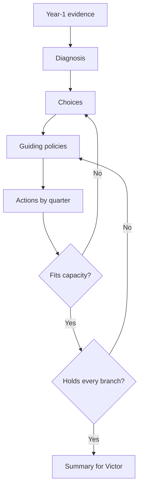

# Project 7: Design a 12-Month Engineering Strategy

It is weeks 46 to 48, late in quarter 4 of your first year as Engineering Director at Northstar
Technologies, the fictional company of the [case study](../case-studies/northstar/index.md). The
twelve-month mandate ends with this quarter. Quarter 3 is the latest measured quarter. It came in at 14
[Sev1 and Sev2](../glossary.md#severity-sev1-sev2-sev3) incidents (the first quarter at or below the mandate's 15), 99.89 percent availability on the
contractual paths (about 13 minutes short of the 99.9 percent commitment), $60,000 of service credits,
and [unplanned work](../glossary.md#unplanned-work) at 25 percent. Year 2 (quarters 5 to 8, weeks 53
to 104) is being decided one document at a time: the year-2 organization proposal, the engineering page
of the board plan, the VP question, the quality [continuation](../glossary.md#the-continuation), and the
workforce plan. Above them, Victor Lindqvist (CTO) is drafting a three-year technology strategy. In week
47 he sorts technology into excellent, adequate, buy, and not doing, sets four policies, and asks you
for its year-2 inputs. Each of these is a reasonable document. None of them says what engineering will
do in year 2 under Victor's direction, or why the year-2 pieces add up. Your job is to write that
document for him: a 12-month engineering strategy, the year-2 layer beneath his draft, that the other
year-2 decisions can be tested against.

The project applies [Chapter 51](../parts/12-cto-leadership/51-enterprise-technology-strategy.md), which shows how a CTO derives technology strategy from business
strategy and lays out a multi-year roadmap; this project is the 12-month engineering layer beneath it. It also
uses [Chapter 30](../parts/06-technical-leadership/30-technical-strategy-and-technology-selection.md) for
the strategy kernel and the week-14 strategy draft,
[Chapter 29](../parts/06-technical-leadership/29-staff-and-principal-engineers.md) for staff engineers as
owners of policies, [Chapter 38](../parts/08-management-operating-system/38-scorecards-quarterly-planning-and-capacity-allocation.md)
for capacity allocation, and Chapters
[45](../parts/10-business-leadership/45-business-models-and-engineering-economics.md) to
[49](../parts/11-vp-engineering/49-multi-year-transformation-communication-and-politics.md) for
economics, negotiation, the VP question, workforce and governance, and staged transformation. The
templates are the [engineering strategy](../templates/engineering-strategy.md), the
[capacity planning model](../templates/capacity-planning-model.md), the
[quarterly engineering review](../templates/quarterly-engineering-review.md), and the
[executive update](../templates/executive-update.md). After that reading, the full project takes about
22 to 28 hours.

!!! note "Core version (about 8 to 10 hours)"
    Do deliverables 2, 3, 4, and 10 only: the diagnosis, the strategic choices, the guiding policies,
    and the one-page summary. Apply acceptance criteria 1, 2, 3, and 10, and score the rubric rows
    Diagnosis, Choices and policies, and Evaluation and communication (50 of the 100 points; rescale
    to 100).

## Problem Statement

Northstar has had a written technical strategy since week 14. The draft in
[Chapter 30](../parts/06-technical-leadership/30-technical-strategy-and-technology-selection.md) and the
[template example](../templates/engineering-strategy.md#example-northstar-week-14-draft) diagnosed three
problems: change is unsafe, the estate ages unwatched, and knowledge is concentrated. It set three
guiding policies, each tested against a decision waiting in the [decision log](../glossary.md#decision-log): the
CI consolidation target (DL-10), the tax-svc build, buy, or hybrid choice (DL-09), and the migration of
[Core](../glossary.md#core)'s framework (TR-01 on the technology risk register). By week 47 none of the
three is recorded as decided. The diagnosis was sound; the policies decided nothing.

The situation has also moved. Incidents have more than halved, so the argument that funded prevention in
year 1 (outages and credits) is weaker, and Greg Tanaka (VP Sales) argues that the prevention engineers
should move to deal features. The customer harm that is now most visible is correctness: in week 40 a
top-40 distributor complained about time spent correcting orders, and Data and Analytics found 7,800
corrected orders in the last 28 days of quarter 3, 1.3 percent of submissions. Six of the 40 largest
customers renew in quarters 5 to 8. Year 2 may bring a new team structure, a VP above the director, and
less prevention capacity, all inside the same 87 seats.

A year-2 strategy therefore has four jobs. It must diagnose today rather than week 14. It must choose where
engineering will be excellent and where adequate is enough (the kind of explicit choice
[Lafley and Martin, 2013](../references/bibliography.md#lafley2013playing) are known for asking of a
business, applied here to an engineering organization; **expert opinion**). It must set a few policies
that decide the open questions the same way every time. And it must fund its actions inside flat
headcount, holding whatever Victor Lindqvist and the executive team decide on the items still open.

Your task is to write the strategy. It has a diagnosis of no more than three findings, two to four
guiding policies, coherent actions by quarter with owners and dates, a capacity envelope, what
engineering will not do, review triggers, and a short scorecard. Add a one-page summary for Victor and an
evaluation of the week-14 draft against what happened to it.

## Scenario and Constraints

**Your position.** Engineering Director, drafting CTO-level work for Victor Lindqvist, who approves it.
The three staff engineers (Ines Carvalho, Kwame Mensah, Li Na Zhou) are co-authors. The
[cast](../case-studies/northstar/cast.md) lists everyone named here; Helena Marsh is the CEO and Sofia
Alvarez the VP Customer Success. The managers, Amara
Okafor (CPO), and Rajiv Menon (CFO) read it before Victor does. The executive team meets in week 49 and
the board in week 50.

**The time rule.** Use only facts dated week 47 or earlier ([weeks](../glossary.md#weeks-quarters-and-years)
count from the director's first week). The fact sheet under Starting Dataset lists the case facts the
project needs, each with its week; anything else you use from the case must also be dated week 47 or
earlier. Quarter 4 results do not exist yet. Victor's week 48 premortem and the week 49 executive
meeting are after the time rule. No outcome is recorded for any decision due in weeks 46 to 51; treat
each as open.

**Constraints.** These are binding.

1. **The kernel, and short.** No more than three findings and two to four guiding policies. At most about
   six pages, plus the one-page summary.
2. **Flat headcount.** 87 seats for the whole engineering organization; backfills allowed, no net
   additions, no headcount request (Victor will not take one to the board). State the seat count you plan
   on: 80 engineers today, 79 under the main organization proposal, 78 if a VP takes a seat.
3. **No Core rewrite** (constraint 3 on the [Northstar overview](../case-studies/northstar/index.md)).
4. **Open decisions stay open.** The year-2 organization, the VP question, the continuation (6 FTE, or 4
   FTE plus two engineers on deal features), the workforce plan, the week 32 portfolio forum (on a third deal feature), the CI
   target, ADR-0001, tax-svc, and the board's envelope. You may recommend; you must show how the strategy
   changes under each outcome you consider plausible.
5. **No new cash assumed.** The $150,000 of tooling in the continuation needs Rajiv Menon's approval with an
   offset in the $4.2M cloud and tooling budget. The strategy must work if it is declined.
6. **Owners who are not you.** Every guiding policy has a named owner who decides exceptions within a stated
   time. The director may own at most one.
7. **Consistent with the board page and Victor's draft.** The strategy either fits the director's week-42
   draft counter and Victor's week 47 draft or says
   where it departs and why.

## Starting Dataset

Use these sources:

- [Northstar overview](../case-studies/northstar/index.md), including
  [executive and board context](../case-studies/northstar/index.md#executive-and-board-context);
  [baseline data](../case-studies/northstar/baseline-data.md), especially the extended baseline on
  architecture, estate, and people; and [the year 1 record](../case-studies/northstar/first-quarter.md),
  especially the year 2 proposal, "Quarter 3 results", "Quarter 4", and
  [executive and company facts in quarter 4](../case-studies/northstar/first-quarter.md#executive-and-company-facts-in-quarter-4)
  for Victor's week 47 draft (four groups, four policies, draft allocation, options and decision weeks) and
  Finance's fiscal year 1 figures.
- The week-14 strategy draft and the technology risk register TR-01 to TR-09 in
  [Chapter 30](../parts/06-technical-leadership/30-technical-strategy-and-technology-selection.md), and the
  [engineering strategy template](../templates/engineering-strategy.md) with its example.
- [Chapter 38](../parts/08-management-operating-system/38-scorecards-quarterly-planning-and-capacity-allocation.md)
  for the quarter 3 capacity plan; [Chapter 45](../parts/10-business-leadership/45-business-models-and-engineering-economics.md)
  for the economic assumptions; [Chapter 46](../parts/10-business-leadership/46-stakeholder-management-and-negotiation.md#case-study)
  for the board page and the draft counter; [Chapter 47](../parts/11-vp-engineering/47-the-vp-of-engineering.md#case-study)
  for the VP options; [Chapter 48](../parts/11-vp-engineering/48-capacity-strategy-workforce-planning-and-governance.md)
  for workforce and governance; [Chapter 49](../parts/11-vp-engineering/49-multi-year-transformation-communication-and-politics.md#case-study)
  for the continuation and the executives' positions.

**Project data.** Two files, both **from the case**, not new:
[`p7-year1-readings.csv`](data/p7-year1-readings.csv) gathers the measures Northstar's record reports
for the baseline quarter and quarters 1 to 3, and [`p7-open-decisions.csv`](data/p7-open-decisions.csv)
lists the open decisions with their decider, due date, and the recorded options. Blank cells mean the
value is not recorded; do not fill them with estimates presented as readings.

**Project fact sheet.** Every case fact the submission must use, one per row, each dated week 47 or
earlier. You do not need to search the case pages for these.

| Fact | Value | Week | Source |
|---|---|---|---|
| Sev1 and Sev2 incidents | 30 at baseline; 21, 17, 14 in quarters 1 to 3 | Weeks 13, 26, 39 | [Timeline](../case-studies/northstar/timeline.md) |
| Availability, contractual paths | 99.62 percent; not recorded; 99.86; 99.89 (about 144 of 131,040 minutes unavailable in quarter 3, where 99.9 allows about 131) | Weeks 13, 26, 39 | [Timeline](../case-studies/northstar/timeline.md) |
| Service credits a quarter | $410,000; not recorded; $95,000; $60,000 | Weeks 13, 26, 39 | [Timeline](../case-studies/northstar/timeline.md) |
| Unplanned work | 34, 31, 28, 25 percent | Weeks 13, 26, 39 | [Timeline](../case-studies/northstar/timeline.md) |
| Tier 1 at the four operational minimums | 3, 8, 11, 13 of 15 | Weeks 13, 26, 39 | [Timeline](../case-studies/northstar/timeline.md) |
| Correctness failures | 8 of the 14 baseline customer-detected incidents | Baseline quarter | [Baseline data](../case-studies/northstar/baseline-data.md) |
| Invoice correctness SLO | 99.99 percent, defined but dependent on reconciliation | Year 1 | [Year 1 record](../case-studies/northstar/first-quarter.md) |
| Corrected orders | 7,800 of about 600,000 submissions in 28 days (1.3 percent) | Week 40 | [Calendar of quarter 4](../case-studies/northstar/first-quarter.md#calendar-of-quarter-4) |
| Corrected-order sample | 400 corrections, 340 errors: price changes 130, wrong unit 85, duplicate submissions 70 (no idempotency key), wrong delivery site 35, other 20 | Weeks 40–41 | [Calendar of quarter 4](../case-studies/northstar/first-quarter.md#calendar-of-quarter-4) |
| Build systems | Four; the CI (continuous integration) target is open | Baseline; open | [Baseline data](../case-studies/northstar/baseline-data.md) |
| TR-01, Core's framework | Past free community support; 120 to 180 engineer-days to migrate (the register's estimate) | Week 14 | [Chapter 30](../parts/06-technical-leadership/30-technical-strategy-and-technology-selection.md) |
| Technology risk register | TR-01 to TR-09 ([register IDs](../glossary.md#register-ids)) | Week 14 | [Chapter 30](../parts/06-technical-leadership/30-technical-strategy-and-technology-selection.md) |
| Ledger knowledge | Currency and rounding changed safely by one person | Baseline | [Ledger knowledge map](../case-studies/northstar/baseline-data.md#billing-on-call-and-ledger-knowledge) |
| Succession | 10 critical roles; none with a ready-now successor; 4 with no cover | Week 44 | [Chapter 36](../parts/07-organization-design/36-reorganizations-evolution-and-succession.md) |
| core/permissions | Exemption from having an owner lapsed | Week 39 | [Year 1 record](../case-studies/northstar/first-quarter.md) |
| Main organization proposal | 79 engineers, 7 managers, the director; about 21 engineer-weeks of transition cost; document-store has no owner | Week 44 | [Year-2 organization proposal](../case-studies/northstar/first-quarter.md#the-year-2-organization-proposal-week-44) |
| Organization alternatives | B: keep Customer Experience whole (80 engineers, 6 managers); C: also split Orders and grow the platform (78, 8); D: two managers of managers (77, 9) | Week 44 | [Year-2 organization proposal](../case-studies/northstar/first-quarter.md#the-year-2-organization-proposal-week-44) |
| VP question | Recommendation due week 48 | Week 45 | [Calendar of quarter 4](../case-studies/northstar/first-quarter.md#calendar-of-quarter-4) |
| Quarter 3 capacity plan | Unplanned work 22 percent planned, 28 cautious; prevention 8 FTE; platform 4.5; product 49.9 planned, 45.1 cautious | Week 26 | [Chapter 38](../parts/08-management-operating-system/38-scorecards-quarterly-planning-and-capacity-allocation.md) |
| The continuation | 6 FTE of prevention in quarters 5 and 6, 5 FTE in quarters 7 and 8; gates in weeks 56, 78, and 104 | Week 45 | [Calendar of quarter 4](../case-studies/northstar/first-quarter.md#calendar-of-quarter-4) |
| Draft board counter | At or below 40 Sev1 and Sev2 over year 2 as a rolling four-quarter total; 99.9 percent every quarter; two consecutive quarters above 12 reopen prevention | Week 42 | [Calendar of quarter 4](../case-studies/northstar/first-quarter.md#calendar-of-quarter-4) |
| Business choices | Mid-market distributors, with the largest 40 mattering most; trusted with money; cross-border growth moved to year 3 | Week 46 | [Three-year technology strategy](../case-studies/northstar/first-quarter.md#three-year-technology-strategy-chapter-51) |
| Victor's draft: excellent | Financial correctness; availability of order and payment paths; accounting and bank integration; safe weekly change | Week 47 | [Three-year technology strategy](../case-studies/northstar/first-quarter.md#three-year-technology-strategy-chapter-51) |
| Victor's draft: adequate and buy | Adequate: ordering screens, internal reporting, Core module structure. Buy: tax content, CI and observability tooling, corporate business systems | Week 47 | [Three-year technology strategy](../case-studies/northstar/first-quarter.md#three-year-technology-strategy-chapter-51) |
| Victor's draft: not doing for three years | Core rewrite; multi-region active-active; customer-specific code branches; a new tier 1 runtime or datastore without retiring one | Week 47 | [Three-year technology strategy](../case-studies/northstar/first-quarter.md#three-year-technology-strategy-chapter-51) |
| Victor's draft: policies | Reliability before reach; money data moves by contract or events, never tables ([ADR-0001](../glossary.md#adr-0001) decided by week 60); converge before adding; stage anything above 10 FTE-quarters | Week 47 | [Three-year technology strategy](../case-studies/northstar/first-quarter.md#three-year-technology-strategy-chapter-51) |
| Victor's draft: year-2 allocation (FTE, 79 engineers) | Unplanned 17.4; prevention 5.5; platform 4.5; estate currency 2.0; product for today's customers 37.6; horizon 2 10.0; horizon 3 2.0 | Week 47 | [Three-year technology strategy](../case-studies/northstar/first-quarter.md#three-year-technology-strategy-chapter-51) |
| CI target | Chosen at the week 78 gate | Week 47 | [Three-year technology strategy](../case-studies/northstar/first-quarter.md#three-year-technology-strategy-chapter-51) |
| Helena Marsh (CEO) | Six of the 40 largest customers renew in quarters 5 to 8 | Weeks 46–47 | [Calendar of quarter 4](../case-studies/northstar/first-quarter.md#calendar-of-quarter-4) |
| Rajiv Menon (CFO) | Operating expense flat; any new cash offset | Weeks 46–47 | [Calendar of quarter 4](../case-studies/northstar/first-quarter.md#calendar-of-quarter-4) |
| Greg Tanaka (VP Sales) | Prevention engineers to deal features; a private offer in week 47 that the director declined | Weeks 46–47 | [Calendar of quarter 4](../case-studies/northstar/first-quarter.md#calendar-of-quarter-4) |
| Amara Okafor (CPO); Sofia Alvarez (VP Customer Success) | Allocation fixed per stage; customer incident notifications kept | Weeks 46–47 | [Calendar of quarter 4](../case-studies/northstar/first-quarter.md#calendar-of-quarter-4) |
| Money | $185,000 per engineer-year; $3,558 per engineer-week, the planning rate; $46,250 per FTE-quarter; gross margin 72 percent; discount rate 10 percent; top-40 customers about $1.17M ARR each | Quarter 4 | [Quarter 4 assumptions](../case-studies/northstar/first-quarter.md#assumptions-and-people-used-in-quarter-4) |

**Facts you do not have.** Quarter 4 results; the outcome of the week 46 organization decision, the VP
recommendation, the continuation, the workforce plan, the week 32 forum, and the board meeting; whether the
deployment-event store, CI consolidation phase 1, or a general invoice reconciliation job is running;
quarter 3 change failure rate, recurrences, and customer-detected share; any committed-delivery figure
after the baseline quarter; and how Victor will revise his draft after week 47. Treat each as a gap with an action, not a value.

## Required Deliverables

One strategy document of no more than about six pages, a one-page summary, and your spreadsheet.

1. **Evaluation of the week-14 draft.** For each of its three policies: the decision it was tested against,
   what happened to that decision by week 47, and whether the policy should be kept, rewritten, or
   dropped. Say why the draft decided so little.
2. **Diagnosis.** No more than three findings, each with numbers from the case and the business
   consequence, written for year 2 rather than copied from week 14.
3. **Strategic choices.** Where engineering will be excellent in year 2, where adequate is enough, and what
   waits for year 3, mapped to the four groups in Victor's week 47 draft, with any departure from it stated
   and argued.
4. **Guiding policies.** Two to four, each with the finding it answers, its cost (the freedom it removes),
   its owner and exception time, one year-1 decision it would have settled, and one open decision it
   settles now.
5. **Coherent actions by quarter.** Enforcements, escalations, and transitions for quarters 5 to 8, each with
   an owner, a due week, and a capacity estimate labeled as yours.
6. **Capacity envelope.** Engineers, unplanned work (planned and cautious), prevention, platform,
   transition, and product for each quarter, at your chosen seat count, with the effect of the other seat
   counts and of the 4-plus-2 option.
7. **What we will not do.** At least three options ruled out, including one that a senior person wants.
8. **Branches.** For each open decision, how the strategy changes under each plausible outcome.
9. **Scorecard and review triggers.** Five to seven measures, each with its pair, that tell Victor whether
   the strategy is working; and the observable conditions that reopen it.
10. **One-page summary** for Victor Lindqvist, and the order in which you will workshop the draft.

## Step-by-Step Instructions

1. **Grade the week-14 draft first.** Open [`p7-open-decisions.csv`](data/p7-open-decisions.csv) and find each
   of the draft's test decisions. A policy whose test decision is still open after 33 weeks tells you
   something about the policy, not only about the decision.
2. **Rebuild the readings.** From [`p7-year1-readings.csv`](data/p7-year1-readings.csv), recompute what you
   will cite: the incident change with its uncertainty, the availability gap in minutes, credits annualized,
   unplanned work in FTE and dollars, the corrected-order error rate.
3. **Write the diagnosis** as causes, not symptoms. Ask what makes year 2 hard that did not make year 1 hard.
4. **Make the choices explicit.** Name what engineering will be excellent at, and what it will accept as
   adequate. A choice that disappoints nobody is not a choice.
5. **Draft policies and test them** against a past decision and an open one. Check that a team could tell
   whether a proposal complies ([Larson, 2023](../references/bibliography.md#larson2023engstrategy)).
6. **Turn each policy into actions,** at least one enforcement per policy, and give every escalation a date.
7. **Price the actions** against the capacity envelope. Plan from the cautious case, as
   [Chapter 38](../parts/08-management-operating-system/38-scorecards-quarterly-planning-and-capacity-allocation.md)
   does, and expect your own estimates to be optimistic
   ([Buehler et al., 1994](../references/bibliography.md#buehler1994exploring)).
8. **Write the branches** for each open decision. If an outcome would break a policy, the policy is too
   dependent on one person's choice.
9. **Choose the scorecard and the triggers.** Reuse the board page's measures where you can, so that the
   strategy and the board report do not disagree.
10. **Run the coherence checks** (below), then write the one-page summary last.

The two loops are where most drafts change: actions that do not fit the cautious case send you back to
the choices, and a policy that breaks under one executive decision sends you back to rewrite it.

**Coherence checks.** Every policy answers a finding; every finding has a policy; every action traces to a
policy; the capacity rows sum to the seat count; every "will not do" line disappoints a named person; and
every policy would have settled a real year-1 decision.

## Explicit Trade-offs

| Trade-off | The tension at Northstar |
|---|---|
| Reliability against deal features | Incidents are down and Greg Tanaka wants the prevention engineers; six top-40 renewals in quarters 5 to 8 and an availability miss of 13 minutes say reliability is not finished |
| Availability against correctness | The contract and the board measure availability; customers now feel corrections, which no availability measure sees |
| A strategy that decides against one that waits | Writing policies that settle the CI target or ADR-0001 takes a position before Victor decides; leaving them open repeats week 14 |
| Convergence against capacity | Finishing the CI consolidation and the framework migration costs capacity the continuation is cutting from 8 FTE to 6 and 5 |
| One plan against branches | A strategy written for one organization outcome is simple and fragile; one written for four is robust and hard to read |
| Stability against learning | Allocations changed rarely let teams plan ([Larson, 2023](../references/bibliography.md#larson2023planning)); the trigger at two quarters above 12 changes them on evidence |
| Even shares against focus | Spreading prevention across all teams is easy to defend; allocations tend to drift toward equal shares by unit whatever the need ([Bardolet et al., 2011](../references/bibliography.md#bardolet2011capital)) |
| Writing it with the staff engineers against writing it fast | Co-authors make policies enforceable and take weeks; the board is in week 50 |

## Acceptance Criteria

A submission is accepted only if all of these hold.

1. The diagnosis has no more than three findings, each with at least one number traceable to the case.
2. There are two to four guiding policies, each with a cost, an owner other than the director (at most one
   owned by the director), an exception time, and the finding it answers.
3. Each policy is tested against a real year-1 decision and settles at least one decision open in week 47.
4. Every action has an owner, a due week, and a policy it serves; every policy has at least one enforcement.
5. The capacity envelope sums to the stated seat count in every quarter, uses a cautious case, and shows the
   other seat counts and the 4-plus-2 option.
6. "What we will not do" names at least three options, one of them wanted by a named senior person.
7. Every open decision in the time window has a branch, and no outcome after week 47 is recorded as fact.
8. The scorecard has five to seven paired measures and is consistent with the board page or explains why not.
9. The evaluation of the week-14 draft says what happened to each of its test decisions.
10. No fact about Northstar is invented; estimates and assumptions are labeled as yours.

## Evaluation Rubric

Weights total 100. A strong pass is 75 or more with no criterion weak.

| Criterion | Weight | Excellent | Adequate | Weak |
|---|---|---|---|---|
| Diagnosis | 20 | Three or fewer causes specific to year 2, each with recomputed numbers and a business consequence; correctness and concentration seen, not only incidents | Findings with numbers, partly copied from week 14 | Goals or symptoms ("improve quality"); no numbers |
| Choices and policies | 20 | Explicit excellent and adequate areas; policies applicable, costly, owned, tested against past and open decisions | Policies with owners; tests thin | Slogans that cost nothing; the director owns everything |
| Actions and roadmap | 15 | Enforcements, escalations with dates, and transitions by quarter; each traced to a policy | Dated actions, some untraced | A project list with no enforcement |
| Capacity and economics | 15 | Envelope from the cautious case at a stated seat count; actions priced; seat-count and 4-plus-2 effects shown | Envelope present; one case only | No numbers, or plans that exceed the seats |
| Uncertainty and open decisions | 10 | Every open decision branched; incident changes read with intervals; nothing after week 47 treated as known | Branches for the main decisions | Open decisions assumed settled |
| Measurement and triggers | 10 | Paired measures shared with the board page; triggers observable without a meeting | Measures without pairs, or triggers without data sources | No way to tell if the strategy works |
| Evaluation and communication | 10 | Honest grading of the week-14 draft; a summary Victor can read in two minutes; a workshop order that reaches the people the policies constrain | Summary present | No evaluation; summary restates the document |

## Solution

The worked solution, with the week-14 draft graded, the capacity envelope computed at three seat counts,
and one complete strategy, is in [Project 7 solution](solutions/p7-solution.md).
