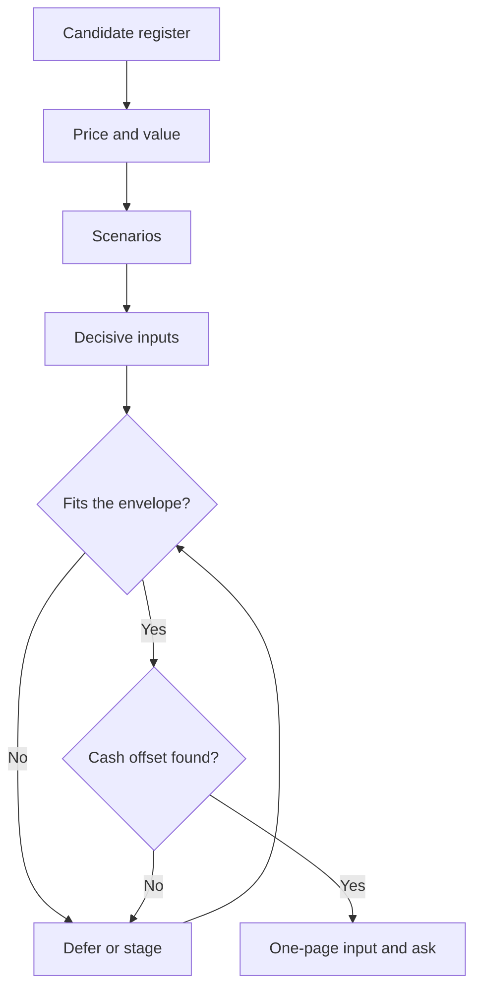

# Project 8: Build a CTO Technology Investment Proposal

You are Victor Lindqvist, CTO of Northstar Technologies, the fictional company of the
[case study](../case-studies/northstar/index.md), and it is week 47 of the Engineering Director's first
year. The executive team meets in week 49. The board meets in week 50, where Helena Marsh (CEO) presents
the year-2 operating plan and budget envelope for approval. Decisions inside the envelope stay with
management; your own agenda item is your three-year technology strategy, for discussion.

On your desk are four things. The director's two-year [continuation](../glossary.md#the-continuation)
of the quality program asks for 6 [FTE](../glossary.md#fte) of prevention in quarters 5 and 6, 5 FTE in
quarters 7 and 8, $150,000 of tooling, and $100,000 more if a CI target is chosen. A technology
[risk register](../glossary.md#risk-register) has had its two highest items open since week 14. Rajiv
Menon (CFO) will accept new cash only if it is offset inside the $4.2M cloud and tooling budget. And
Helena Marsh asks whether reliability will hold through six renewals of top-40 customers, while Greg
Tanaka (VP Sales) argues that the prevention engineers belong on deal features.

Your job is to build the technology investment proposal you would take to the executive team in week
49. It is a portfolio of candidate investments, priced in capacity and cash, valued with scenarios,
sequenced by [cost of delay](../glossary.md#cost-of-delay), and fitted to the envelope. It ends with a
recommended package, a one-page engineering input to the operating plan, and the gates that would stop
the spending.

The project applies [Chapter 52](../parts/12-cto-leadership/52-technology-investment-budgeting-and-financial-literacy.md), which covers financial statements, budgeting, capitalized and expensed
software, and investment cases with scenarios. It uses
[Chapter 45](../parts/10-business-leadership/45-business-models-and-engineering-economics.md) for value
channels, cost of delay, and [NPV](../glossary.md#net-present-value-npv) (net present value), the
[technology investment business case](../templates/technology-investment-business-case.md) template for
each candidate,
[Chapter 49](../parts/11-vp-engineering/49-multi-year-transformation-communication-and-politics.md) for
staged funding, [Chapter 46](../parts/10-business-leadership/46-stakeholder-management-and-negotiation.md)
for the negotiation, [Chapter 48](../parts/11-vp-engineering/48-capacity-strategy-workforce-planning-and-governance.md)
for the envelope, [Chapter 30](../parts/06-technical-leadership/30-technical-strategy-and-technology-selection.md)
for the risk register, and [Chapter 38](../parts/08-management-operating-system/38-scorecards-quarterly-planning-and-capacity-allocation.md)
for capacity. After that reading, the full project takes about 28 to 35 hours.

!!! note "Core version (about 10 to 12 hours)"
    Do deliverables 2, 3, 5, and 9 only: the priced register, the valuation, the package, and the ask.
    Apply acceptance criteria 2, 3, 4, 5, 7, 9, and 10, and score the rubric rows Pricing and options,
    Valuation and scenarios, Portfolio and envelope, and Decisive inputs and staging (65 of the 100
    points; rescale to 100).

## Problem Statement

Northstar's technology spending has been decided one request at a time. Year 1 funded prevention because
the case was obvious: $410,000 of credits a quarter, 30 serious incidents, $9M of renewals at risk. By
quarter 3 credits were $60,000 a quarter and incidents 14, so the obvious case is gone. What remains is
harder to price. It includes renewal protection for about $7.0M of annual recurring revenue
([ARR](../glossary.md#arr)) and capacity returned from unplanned work. It includes risks that have not
yet produced an incident: an unsupported framework under [Core](../glossary.md#core), the monolith, and
a single partner bank route. And it includes measurement the company does not have (invoice
correctness). Against them stands work with a sponsor and a
revenue story.

The board will see the engineering content of one envelope. It will approve an envelope, not a list, and it will remember whether the
CTO's numbers held a year later. Arnold and Yüce's point that the aim of cost-of-delay estimates is
accuracy rather than precision applies here ([Arnold and Yüce, 2013](../references/bibliography.md#arnold2013blackswan)):
what the board needs is the right order of magnitude, the assumptions that carry it, and what would change
the answer.

Your task is to build the proposal. It holds a priced register of the candidates and a valuation of
each with base, downside, and upside cases. It recommends a package that fits the capacity and cash
envelope, and names the decisive inputs and their break-even values. It says how the funded work would
be booked under Northstar's policy, gives a page of engineering input to the operating plan, and ends
with the ask, its gates, and replies to Greg Tanaka's alternative and Rajiv Menon's offset condition.

## Scenario and Constraints

**Your position.** CTO, with one direct report, the Engineering Director (87 seats in all). You own
technical direction and the board's technology questions. The director wrote the continuation proposal;
the staff engineers and managers own the estimates. Rajiv Menon checks the arithmetic.

**The time rule.** Use facts dated week 47 or earlier. They are in
[quarter 3 results](../case-studies/northstar/first-quarter.md#quarter-3-results), the weeks 40 to 47
entries of the [quarter 4 calendar](../case-studies/northstar/first-quarter.md#calendar-of-quarter-4),
[finances](../case-studies/northstar/first-quarter.md#finances-chapter-52),
[three-year technology strategy](../case-studies/northstar/first-quarter.md#three-year-technology-strategy-chapter-51),
and [risk, security, and compliance](../case-studies/northstar/first-quarter.md#risk-security-and-compliance-chapter-53);
the [timeline](../case-studies/northstar/timeline.md), [cast](../case-studies/northstar/cast.md), and
[quarter 4 briefing](../case-studies/northstar/quarter-4-briefing.md) help you find them (the briefing
also mentions later weeks, which stay off limits). They include the executives' positions from weeks 46
and 47, Finance's week 46 latest estimate for fiscal year 1 and the capitalization policy, Helena Marsh's
week 46 confirmation of the business choices, and your own week 47 three-year strategy draft
([Chapter 51](../parts/12-cto-leadership/51-enterprise-technology-strategy.md)). Quarter 4 results do not
exist. No outcome is recorded for the week 46 organization decision or any later decision; the proposal must hold at 80 engineers, at 79 (the main organization proposal),
and at 78 (if a VP takes a seat).

**Constraints.** These are binding.

1. **Flat headcount.** 87 seats; no requisitions and no headcount request to the board.
2. **Capacity envelope (a project constraint).** The package may use at most 8 FTE in any quarter of year
   2, quarter 3's prevention level, so that the non-product lines do not exceed quarter 3's. The 4.5 FTE
   platform line is held for the Developer Platform's roadmap; a candidate paid from it must name what it
   displaces.
3. **Cash.** Any new cash needs Rajiv Menon's approval, and he will consider it only with an offset in the
   $4.2M cloud and tooling budget. Treat the year-1 discretionary $250,000 as committed.
4. **Decision rights.** The board approves the envelope inside the operating plan the CEO presents; the
   executive team decides the continuation (decisions requested by week 51). You recommend. Say what each
   body is asked to approve.
5. **Capacity is not cash.** Saved engineer time is labeled capacity. Benefits you cannot count are named,
   not priced; you may state what they would have to be worth (a break-even).
6. **Options for every candidate,** including doing nothing and a partial or cheaper option.
7. **Use Finance's figures and policy.** Use the fiscal year 1 latest estimate and the capitalization policy
   in [finances](../case-studies/northstar/first-quarter.md#finances-chapter-52). Present the case on a
   cash and capacity basis and show the accounting effect separately; do not invent statement figures the
   case does not give.

## Starting Dataset

Use these sources:

- [Northstar overview](../case-studies/northstar/index.md), including
  [executive and board context](../case-studies/northstar/index.md#executive-and-board-context); [baseline data](../case-studies/northstar/baseline-data.md), especially "Money", reliability,
  security, and the architecture and estate tables; [the first quarter](../case-studies/northstar/first-quarter.md),
  especially "Quarter 3 results", "Quarter 4", and
  [executive and company facts in quarter 4](../case-studies/northstar/first-quarter.md#executive-and-company-facts-in-quarter-4)
  (Finance's fiscal year 1 statements, the capitalization policy, the TR-01 cost scenarios, and your week 47 strategy draft); and
  [`incidents-last-quarter.csv`](../case-studies/northstar/data/incidents-last-quarter.csv) for INC-409
  (duplicate invoices from a retried batch job) and INC-413 (a partner bank outage with no fallback
  route).
- The risk register in [Chapter 30](../parts/06-technical-leadership/30-technical-strategy-and-technology-selection.md),
  the CI consolidation example in the [business case template](../templates/technology-investment-business-case.md#example-northstar-ci-consolidation),
  the continuation proposal and executive positions in [Chapter 49](../parts/11-vp-engineering/49-multi-year-transformation-communication-and-politics.md#case-study),
  the economic assumptions in [Chapter 45](../parts/10-business-leadership/45-business-models-and-engineering-economics.md),
  and the case study in [Chapter 52](../parts/12-cto-leadership/52-technology-investment-budgeting-and-financial-literacy.md#case-study),
  which prices TR-01 against extended support.

**Project data.** [`p8-investment-candidates.csv`](data/p8-investment-candidates.csv) lists eight candidate
rows (C1a to C6) with effort ranges, cash, run cost, and evidence. Each row says whether it comes
**from the case**, is **derived from the case**, or is **invented for this project**. TR-01, the Core framework migration, uses Finance's scenarios and the $60,000 a year
extended-support assumption of Chapters 30 and 52, so that the same item has the same price throughout the
book. The invented figures (the bank route's effort and fee, outage frequency and credits, the reconciliation job's effort) exist only
so that every learner prices the same thing; they are not part of Northstar's record.
[`p8-cash-offsets.csv`](data/p8-cash-offsets.csv) lists three possible offsets, all invented for this
project, with a confidence for each.

**Facts your submission must use.**

| Area | Facts |
|---|---|
| Economics | $185,000 per engineer-year; $46,250 per FTE-quarter; about $3,558 per engineer-week ($185,000 ÷ 52); $800 per engineer-day in Chapter 30's tax-svc case; gross margin 72 percent; discount rate 10 percent; ARR $140M; top-40 customers about $1.17M ARR each; engineering people plus cloud and tooling $20.3M (14.5 percent of ARR) |
| Results | Sev1 and Sev2 30, 21, 17, 14; availability 99.62, not recorded, 99.86, 99.89 percent; credits $410,000, not recorded, $95,000, $60,000; unplanned work 34, 31, 28, 25 percent |
| Continuation | Stage 2: 6 FTE, $150,000 tooling, gate week 78; stage 3: 5 FTE, $100,000 only if a CI target is chosen, gate week 104; Greg Tanaka's alternative of 4 FTE plus two engineers on deal features in quarters 5 and 6 (about $185,000 of capacity) |
| Finances | Fiscal year 1 latest estimate: revenue $145.0M, operating income $21.0M (14.5 percent), cash $73.5M at year end, no debt; engineering personnel expensed $13.7M; capitalized engineering $2.4M (about 15.3 FTE-years). Policy: coding and testing on budget-authorized projects that add functionality is capitalized at $157,250 per FTE-year and amortized over three years; maintenance, incident work, prevention, and refactoring are expensed. The $4.2M is $3.1M production hosting and $1.1M development tooling |
| Risks | TR-01 Core framework past free support (score 9; Chapter 30's range 120 to 180 engineer-days; Finance's scenarios 120, 190, and 243 engineer-days, expensed; extended support assumed at $60,000 a year); TR-08 one partner bank route (INC-413: Sev1, 150 minutes, a recurrence); four build systems (about 1.5 FTE a year to run; one system about 0.5); invoice correctness SLO needs reconciliation; 8 of 14 baseline customer-detected incidents were correctness failures |
| Stakeholders | Helena Marsh: six of the 40 largest customers renew in quarters 5 to 8. Rajiv Menon: operating expense flat; offsets inside the $4.2M. Greg Tanaka: prevention engineers to deal features. Amara Okafor: allocation fixed per stage. Sofia Alvarez: customer incident notifications kept |

**Facts you do not have.** Quarter 4 results; any decision after week 47; whether CI consolidation phase 1
or a general reconciliation job is running; the revenue value of the deal features Greg Tanaka wants;
how service credits are computed in the contracts; whether Finance would treat the bank route or the
reconciliation job as adding functionality; and a real vendor quote for anything. Treat each as an input to obtain, with an owner.

## Required Deliverables

A proposal of no more than about eight pages, a one-page engineering input to the operating plan, and your
spreadsheet.

1. **The decision in board terms.** What the board approves, what the executive team decides, and what you
   decide, in one paragraph each.
2. **Priced register.** For each candidate: options (including do nothing and a partial option), one-time
   capacity and cash, run cost, and the displaced work.
3. **Valuation.** Value channel, formula, factor owners, and probability for each benefit; base, downside,
   and upside cases; payback and three-year NPV at 10 percent; capacity and cash shown separately.
4. **Cost of delay and sequencing.** Dollars per week, urgency profile, and the order in which the package
   runs across quarters 5 to 8.
5. **The package.** Which candidates are funded, deferred, or declined; capacity per quarter against the 8
   FTE envelope; cash against identified offsets with their confidence.
6. **Decisive inputs.** For the package and for each funded candidate, the least certain input and the
   value at which you would change the recommendation.
7. **Accounting note.** How each funded candidate would be booked under Northstar's policy, what you will ask
   Rajiv Menon to confirm, and why the recommendation does not depend on it.
8. **Engineering input to the operating plan.** One page for the envelope the CEO presents: what it needs to
   contain, what it buys, what it does not, the gates.
9. **The ask.** Decision, decider, date, funding source, checkpoints with stop conditions, and a review date
   for comparing estimates with outcomes.
10. **Replies** to Greg Tanaka's 4-plus-2 alternative and to Rajiv Menon's offset condition, each priced.

## Step-by-Step Instructions

1. **Write the decision first.** Separate what the board approves (an envelope) from what the executive team
   decides (the continuation) and what you decide (the order of technical work).
2. **Fix the conventions.** Choose one rate for effort and say it ($3,558 an engineer-week, or $800 an
   engineer-day, which is not the same thing at five days a week), the timing of flows, and the horizon.
   Mixing them is the most common arithmetic error in this project.
3. **Price each candidate** with its options. For TR-01, compare migrating with buying extended support and
   with doing nothing; for the bank route, compare building with accepting the risk. Use the high end of each
   effort range in the downside case: people predicting their own completion times were consistently optimistic in experiments
   ([Buehler et al., 1994](../references/bibliography.md#buehler1994exploring); **research finding**).
4. **State the counterfactual for the continuation.** Its value is the difference between what happens with
   it and what happens without it. Write both, and own the assumption.
5. **Value by channel,** keeping capacity and cash in separate columns. Use the
   [business case template](../templates/technology-investment-business-case.md) for each funded candidate.
6. **Compute scenarios,** then find the input that flips each answer. Report a payback period only beside
   NPV, because payback ignores what happens after it
   ([Dahlquist and Knight, 2022](../references/bibliography.md#dahlquist2022finance)).
7. **Sequence by cost of delay** (the idea Reinertsen is known for putting at the center of product
   decisions; [Reinertsen, 2009](../references/bibliography.md#reinertsen2009principles)), scheduling anything
   with a date backward from it, and fit the package to the envelope quarter by quarter.
8. **Match cash to offsets** and say which offsets are uncertain.
9. **Stage the commitments.** Where an input is uncertain and the spend is hard to reverse, fund the step that
   buys the information first; the value of waiting for better information is a real value, not an excuse
   ([Dixit and Pindyck, 1994](../references/bibliography.md#dixit1994investment)).
10. **Write the one-page input and the replies last,** then check every number from its formula. Read the result
   as the board would read a team's recommendation, asking which biases could have shaped it, the approach
   [Kahneman et al., 2011](../references/bibliography.md#kahneman2011bigdecision) are known for (**expert
   opinion**).

The loop through "defer or stage" is where the portfolio is actually chosen; most candidates pass the
valuation and fail the envelope.

## Explicit Trade-offs

| Trade-off | The tension at Northstar |
|---|---|
| Counted against uncounted value | Renewal protection is the largest benefit and the least countable; pricing it invites distrust, leaving it out undervalues prevention |
| Capacity against cash | The prevention engineers are paid either way, so the cash case looks strong; their real cost is the deal features they do not build |
| Migrating against paying to wait | Migrating TR-01 costs capacity once and risks regressions in a codebase with 41 percent line coverage; extended support costs cash every year and changes nothing |
| Insurance against expected value | The bank route is near break-even on expected credits, yet one outage alone would break a quarter's 99.9 percent and a stage 2 exit criterion |
| Measuring against fixing | Invoice reconciliation has no counted return; it is the price of seeing a correctness problem the strategy says matters most |
| One package against staged asks | A single ask is easy to present; staged asks with gates keep the option to stop but invite re-litigation at each gate |
| Offsets against honesty | Low-confidence offsets make the cash ask look neutral; a board that later sees the offset fail remembers the CTO, not the vendor |
| Accounting presentation against economics | How the work is booked can change how cheap it looks without changing what it costs ([Chapter 45](../parts/10-business-leadership/45-business-models-and-engineering-economics.md)) |

## Acceptance Criteria

A submission is accepted only if all of these hold.

1. The proposal separates what the board, the executive team, and the CTO each decide.
2. Every candidate has at least three options, including doing nothing, each with one-time and run costs.
3. One effort rate and one timing convention are stated and used throughout.
4. Capacity and cash are shown separately in every valuation; no capacity is presented as cash.
5. The continuation's counterfactual is stated explicitly, with base, downside, and upside cases.
6. Every funded candidate has a three-year NPV at 10 percent, a cost of delay per week, and a decisive input
   with its break-even value.
7. The package fits 8 FTE in every quarter and holds at 78, 79, and 80 engineers; every cash ask is matched
   to offsets with stated confidence, or the gap is shown.
8. Uncounted benefits are named; any that decide the recommendation are expressed as break-evens, not
   prices.
9. The ask has a decider, a date, checkpoints with stop conditions, and a review date.
10. No fact about Northstar is invented; invented project figures are used as given and labeled.

## Evaluation Rubric

Weights total 100. A strong pass is 75 or more with no criterion weak.

| Criterion | Weight | Excellent | Adequate | Weak |
|---|---|---|---|---|
| Framing and decision rights | 10 | Problem in money and risk; board, executive team, and CTO decisions separated; the envelope is the board's question | Clear ask; decision rights implied | A technology wish list; the board asked to approve projects |
| Pricing and options | 15 | Every candidate with do nothing and a partial option; one convention; displaced work named | Options for most candidates | One option each; mixed rates |
| Valuation and scenarios | 20 | Channels and owners; counterfactual stated; capacity and cash separated; three cases; NPV and payback computed correctly | Valuations correct in the base case | Capacity counted as cash; renewal value priced as certain |
| Portfolio and envelope | 15 | Package fits 8 FTE each quarter and all seat counts; cost-of-delay order; deferrals justified; cash matched to offsets with confidence | Package fits in total, not per quarter | Everything funded; envelope ignored |
| Decisive inputs and staging | 15 | Break-evens for each funded item and the package; information bought first where it pays; stop conditions that someone would act on | Sensitivity on one input | No sensitivity; no stop conditions |
| Board communication | 15 | One page a director could read in two minutes; what it buys and what it does not; the miss risk stated | A summary that lists the candidates | Eight pages for the board; jargon |
| Replies and politics | 10 | Greg's alternative priced on its merits with a break-even; Rajiv's offsets honest about confidence | Polite replies | The alternative dismissed, or offsets overstated |

## Solution

The worked solution, with every candidate priced, the package fitted quarter by quarter, and the board
page, is in [Project 8 solution](solutions/p8-solution.md).
