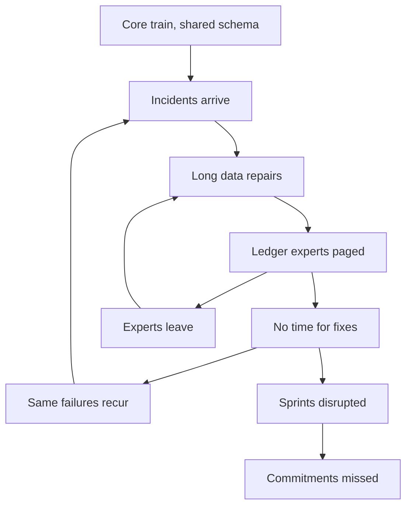

# Project 2 solution: diagnosing Northstar's Billing team

This is one worked answer to [Project 2](../p2-diagnose-a-low-performing-team.md). Its conclusion is
that Billing is not a weak team with a weak manager. The Core release train and the shared schema
explain why Billing's incidents **arrive**; what is specific to Billing explains why they **last**
and **come back**: ledger knowledge held by three overloaded people, no one setting technical direction,
and corrective work that never gets time. The strongest loop is the people loop, so the first action is
on the ledger engineers' load, in week 3, as soon as the diagnosis is shared with Marcus. The reading of Marcus Oyelaran is "keep, fix the system, and
collect evidence", with a decision point at day 90. All Northstar facts are fictional; the interview
notes and sprint item counts are project-only data; estimates marked as this solution's are
assumptions, not canon.

## 1. Evidence inventory

| Source | Production method | Trust | Conclusions that depend on it |
|---|---|---|---|
| Incident file (8 Billing rows) | Incident tracker; severity set by on-call without a written definition | Counts high; severity medium (INC-401 and INC-427 would be Sev1 under the week 3 definitions) | Triggers, detection, recurrence, restoration |
| teams.csv delivery figures | Four CI systems' logs joined by hand | Medium; describe the train more than the team | Only the peer comparison |
| Change failure rate 34% | 72-hour rule, linked by hand | Low; few releases, unlinked failures missed | None on its own |
| Unplanned work 41% | Two-week sample, checked with the manager | Medium; a sample | Capacity estimates |
| Pages (180, 126, 54 of 64, 61 no action) | Reconstructed from the paging tool | High; system data | The people loop |
| Ledger knowledge map | Interviews | Medium; self-assessed | Key-person risk |
| Manager's time split | Self-reported from two weeks of calendar | Medium | Reading of Marcus |
| Sprint item counts | Project-only | Illustrative | Interrupt effect on planning |
| Interview notes | Project-only, nine people | Qualitative | Mechanisms, not magnitudes. The ledger engineer's "half the pages need nothing" overstates the paging tool's 61 of 180 (34 percent): interviews under stress report direction well and magnitude badly |

**Gaps, each with an action.** Billing's escaped defects by detection point: Billing and Kwame Mensah
classify the 58 in week 4 (about 2 engineer-days). Incident review content: read the eight reviews
(about half a day). Survey: none; do not run one in a team of 13 under this stress before the stay
conversations. Job-seeking: ask, in the stay conversations, without pressure.

## 2. Billing's incidents, recomputed

| Fact | Billing | From the incident file |
|---|---|---|
| Sev1 and Sev2 | 8 (2 Sev1: INC-409, INC-417) | 26.7% of 30, from 16.3% of engineers (13 of 80) |
| Triggers | Core train 5, migration 2, latent defect 1 | 7 of 8 change-induced (87.5%), against 19 of 30 (63%) organization-wide |
| Modules | core/invoicing 4, core/ledger 3, tax-svc 1 | All on the money path |
| First detected by | Customer 5, engineer 2, monitoring 1 | 62.5%, against 47% organization-wide; customer detection median 95 minutes |
| Recurrences | 6 of 8 | 6 of the organization's 11 |
| Restoration minutes | 4,480 | 46.9% of the organization's 9,558; median 495 minutes, against 190 for the organization |
| Restoration in recurrences | 3,810 | 85% of Billing's minutes (290 + 540 + 840 + 905 + 135 + 1,100) |

Check: 290 + 540 + 840 + 450 + 905 + 220 + 135 + 1,100 = 4,480; 4,480 ÷ 9,558 = 46.9%.

## 3. Mechanisms

| Mechanism | Evidence | Loop |
|---|---|---|
| The train batches many teams' changes; the schema is shared; migrations are tested against an empty schema | 5 train and 2 migration incidents; Priya's note that Orders cannot tell which changes touch invoicing | Arrival (system) |
| Correctness failures need manual data repair by people who know the ledger | Median restoration 495 minutes; INC-427 took 1,100 with manual repair; no reconciliation | Capability |
| Repairs fall on three people; low-value pages add load | 126 of 180 pages, 54 of 64 after hours; 61 needed no action | People |
| Corrective work never gets time; technical direction is "decided during incidents" | 6 of 8 recurrences; Marcus's 15 percent technical time | Capability |
| Interrupts break sprints, so commitments slip | Scope changed in all 6 sprints; 0 of 3 committed; project-only sprints: 36 of 72 planned items done, 46 added mid-sprint | Trust |
| Missed dates and blame between teams | INC-417 thread; INC-427 review opened with blame | Trust |

## 4. Competing hypotheses

| Hypothesis | Supporting evidence | Disconfirming evidence to seek | How, by week 13 |
|---|---|---|---|
| H1: The system (train, schema, migrations, missing reconciliation) causes Billing's failures | 7 of 8 change-induced; Orders on the same train has similar arrival | Billing's incidents continue at the same rate after the migration check and owner-based reviews land | Track Billing's change-induced incidents per release after each system fix |
| H2: Knowledge concentration and load make failures long and recurrent | Restoration and recurrence far above Orders; ledger map; one expert gone | Restoration time falls without spreading knowledge, or recurrences fall without corrective time | Restoration median and recurrences on ledger and invoicing; people who can respond alone per area |
| H3: The team's engineering skills are weak | 58 escaped defects; 34% change failure | Defects concentrate at integration and migration points (system), not unit logic; Tamsin's gap is specific to ledger operations | Classify the 58 defects by detection point; review the eight incident reviews |
| H4: The manager is not leading | No technical direction; 55% of his time on delivery coordination; scope changed every sprint | His time is consumed by train coordination that the system imposes; he named the problems before you did (interview) | Observe how he uses time freed by the weekly train and alert tuning |

This solution's reading: H1 and H2 are supported; H3 is not supported yet (most of Billing's failures
start at boundaries Billing does not control); H4 is open, and it cannot be tested until the system
stops consuming his week.

## 5. Billing against its peers

| Measure | Billing | Orders (same train) | Payments and Integrations (off the train) |
|---|---|---|---|
| Sev1 and Sev2 | 8 | 7 | 6 |
| Via the Core train | 5 | 4 | 0 |
| Customer-detected | 5 | 4 | 1 |
| Recurrences | 6 | 3 | 1 |
| Restoration minutes (median) | 4,480 (495) | 1,475 (185) | 610 (77.5) |
| Change failure rate | 34% | 29% | 21% |
| Unplanned work | 41% | 36% | 33% |
| Committed delivered | 0 of 3 | 1 of 4 | 2 of 3 |

**What the comparison attributes to the system.** Arrival: Orders, on the same train, has almost the
same count, train share, and customer detection. A diagnosis that blames Billing for the arrival of
incidents would have to blame Orders too.

**What is specific to Billing.** Duration and recurrence: three times Orders' restoration minutes and
twice its recurrences, on similar arrival. That points to H2 (knowledge and load) and to corrective work
not being done, not to the train.

## 6. The one-page diagnosis for Victor Lindqvist

> **Billing is not failing because its people are weak.** Its incidents arrive through the Core train
> and the shared schema, at about the same rate as Orders'. What is specific to Billing is that its
> failures last nearly three times as long and recur twice as often, because ledger repairs depend on three
> engineers who carry 54 of the team's 64 after-hours pages, one of their colleagues already left
> after three weekends of pages, and corrective work never gets time. The strongest loop is people:
> if one more ledger engineer leaves, period close and currency rounding have one or no safe responders.
> **What I will do now:** cut the ledger engineers' low-value pages, start pairing on currency and rounding and
> period close, and hold stay conversations this week; in the quarter's plan, give Billing protected
> prevention time and make migrations safe. **What I will not conclude yet:** anything about Marcus
> Oyelaran's leadership. His week is consumed by the train; I will judge him on what he does with the
> time the fixes free, at day 90. **Confidence:** high on the system and the people loop (paging and
> incident data), medium on the rest (samples and interviews).

## 7. Triage

| Placement | Action | Owner | Cost | Reason |
|---|---|---|---|---|
| Act this week | Stay conversations with the three ledger engineers | Director | 3 × 30 minutes | Key-person risk with irreversible knowledge loss |
| Act this week | Silence or reroute the 61 no-action pages; a non-ledger secondary for after-hours ledger pages | Marcus, with Kwame Mensah | About 1 engineer-week | Cuts the people loop's load fastest |
| Act this week | Ask the ledger engineers about pay and promotion readiness through the normal process | Marcus | Small | The engineer who left took an outside offer; one engineer's pay has not been reviewed in two years |
| Plan this quarter | Pairing on currency and rounding first, then period close: Tamsin Achterberg and one more engineer; her after-hours shadowing starts on credit notes, where she can already respond | Marcus | About 1 engineer-week a week | Raises responders on the two single points of failure (change safely: 1 and 1) |
| Plan this quarter | Migration safety: rehearsal against production-like data, a check for unfinished migrations, and a second engineer able to change schema migrations safely | Li Na Zhou (data and migrations), with Platform Operations | Several engineer-weeks, from prevention | 2 of 8 incidents; failures there need forward fixes |
| Plan this quarter | Protected prevention time for Billing in the week 4 capacity model | Director | A share of Billing's capacity | Breaks the capability loop |
| Plan this quarter | Record which team's change triggered each Core release incident | Kwame Mensah, in the incident classification | Hours | Ends the blame argument with data |
| Early win | Fortnightly Billing and Orders review of order-to-invoice mapping changes | Marcus and Priya Raman | 30 minutes a fortnight | 9 Orders-to-Billing links, 6 of them mapping changes |
| Defer | tax-svc automation (0.6 FTE by hand) | Billing | | Real, but not on the constraint; a build, buy, or hybrid decision later |
| Defer | Billing's process changes (sprint method) | | | Interrupts, not method, break the sprints |

## 8. Provisional reading of Marcus Oyelaran

| Cause (Chapter 9) | Evidence for | Evidence against | Reading |
|---|---|---|---|
| System | Train coordination consumes his week; incidents arrive like Orders'; schema and migrations outside his control | | Strong |
| Skill | Technical direction absent; his technical time is 15 percent | He names the fragility and the train problem himself | Possible: setting technical direction may be a skill gap |
| Will | | He took on release coordination and incident follow-up; no sign of withdrawal | No evidence |
| Role fit | | Unknown until the system load falls | Open |

**Reading: keep, fix the system, collect evidence.** No integrity or harm finding, so Chapter 56's
30-day rule holds. **Evidence by day 90:** whether he reduces scope changes once interrupts fall;
whether he names a technical direction for the ledger (for example, which migrations need rehearsal,
which areas need second responders) instead of deciding during incidents; whether the ledger on-call
load is spread; and how he handles the Orders relationship. **What would move him to coach:** a
specific skill gap (technical direction or planning under interrupts) with willingness to work on it.
**What would move him to replace:** an integrity or harm finding, or no change in his own behavior after
the system fixes and a fair, dated coaching period. **What would make it "keep" with confidence:** he
uses freed time on the ledger's direction without being asked.

## 9. Communication

1. **Marcus, first, privately (week 3).** The diagnosis, with the system finding first; what you will do
   this week and what is his to run; that you are not judging his leadership on numbers the train
   produced; what you will look at by day 90.
2. **The three ledger engineers, individually (week 3).** What you heard, what changes this week, what you
   cannot promise.
3. **The Billing team (week 3, with Marcus leading).** The load and pairing changes; no blame; Marcus
   speaks first.
4. **Priya Raman (week 3).** The comparison shows the train, not Orders, is the cause; ask her to join the
   mapping review. No blame either way.
5. **Victor Lindqvist (end of week 3).** The one-page diagnosis with confidence stated, and the request
   that prevention time for Billing be protected in the week 4 capacity model.

## 10. Measures for the quarter

| Measure | Definition | Tests | Gaming risk and pair |
|---|---|---|---|
| After-hours ledger pages handled by the three | Pages after hours first handled by the three ÷ all after-hours Billing pages | People loop | Silencing real alerts; pair with customer-detected Billing incidents |
| People who can respond alone, per ledger area | From the knowledge map, refreshed monthly | H2 | Self-assessment inflation; pair with a responder drill on one area a month |
| Restoration minutes, Billing incidents | Sum and median per quarter | H2 | Closing incidents before data repair ends; restoration ends when customer data is correct |
| Recurrences on ledger and invoicing | Incidents matching an earlier failure mode | Capability loop | Reclassifying as new; reviewed by Kwame Mensah |
| Billing incidents via the train, with the triggering team recorded | Count per release | H1 | Not linking; pair with release count |
| Sprint scope changes | Items added mid-sprint ÷ planned | Trust loop; H4 | Planning less; pair with committed items delivered |

No per-engineer measure, no target on the incident count.

## With hindsight: what Northstar actually did

The canon records what happened after week 3, outside this project's time rule. It is used here only to
evaluate the diagnosis. In week 4 Billing received the largest prevention share (25 percent) and
core/scheduler became Billing's. The migration check promised after INC-427 slipped; in week 9 a Billing
Sev1 (credit notes applied twice) could not be rolled back because a migration had already changed the
schema, and the check landed in week 11. That supports H1's migration mechanism and the case for placing
migration safety early. The stay interviews with the ledger engineers came in weeks 14 and 15, and in
week 20 Tomasz Wierzbicki reported an outside offer 20 percent above his base: the people loop was still
running, which is why this solution moves those conversations to week 3.

## What a weak submission looks like

> "Billing is our lowest-performing team: most incidents (8), highest change failure rate (34 percent),
> most escaped defects (58), zero roadmap delivery. The team needs better engineering discipline and
> stronger leadership. Actions: put Marcus on a performance plan, add a code-coverage target of 70
> percent, require two approvals on every Billing change, and track defects per engineer."

Against the rubric: numbers taken at face value, including the hand-linked change failure rate (evidence
weak); symptoms listed as causes (mechanisms weak); one explanation assumed, no comparison with Orders
(hypotheses weak); no action on the ledger engineers (triage weak); a performance plan for the manager
on system numbers in week 3, against Chapter 56's rule (manager weak); per-engineer defect tracking,
which constraint 4 forbids (measures weak). It fails acceptance criteria 1 through 8.

**An adequate submission** names the train and the ledger knowledge, recommends sensible actions, and
reads Marcus fairly, but does not recompute the incident facts, does not use Orders as a control, and
leaves the ledger engineers for "later in the quarter". It scores in the 60s. **What separates excellent
from adequate** is the peer comparison that splits arrival from duration and recurrence, and acting on
the people loop in the first weeks.

**Other defensible answers.** Treating migration safety as "act this week" is defensible, given two
migration incidents and the missing reconciliation, if the action is a small interim rule rather than a
project. A reading of Marcus as "coach" from day 30, on the evidence that technical direction is absent,
is defensible if the coaching focus is technical direction and the checkpoint is dated. Running a short
anonymous team survey in week 3 is defensible in a larger team; at 13 people under stress the risk is
that answers identify their authors.

**Scored as a submission, this solution:** evidence 14 of 15, mechanisms 18 of 20, hypotheses 14 of 15,
triage 13 of 15 (the migration costs are approximate), manager 14 of 15, communication 9 of 10, measures 9
of 10. Total 91.
