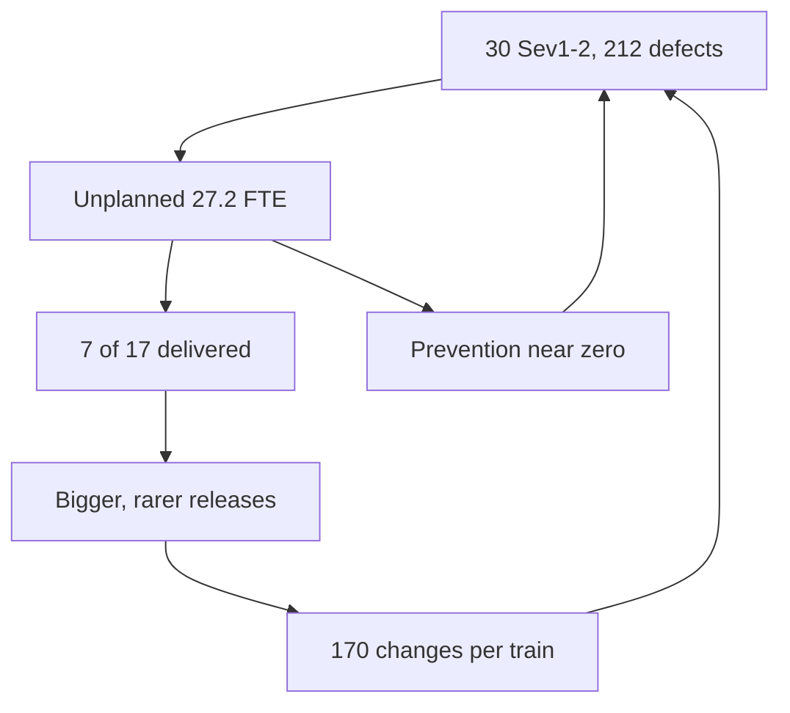

# Project 3 solution: an engineering quality transformation plan for Northstar

This is one worked answer to [Project 3](../p3-quality-transformation-plan.md). It follows the
director's actual choices on the [first quarter](../../case-studies/northstar/first-quarter.md) page
where the baseline data supports them, and departs from them in two places where the data available
at arrival supported a better move. Other answers can score as well; the last sections say which, and
show how the rubric separates a strong plan from a weak one. All Northstar facts are fictional.

People named: Victor Lindqvist (CTO), Amara Okafor (CPO), Rajiv Menon (CFO), Helena Marsh (CEO), Sofia
Alvarez (VP Customer Success), Elena Sokolova (Payments and Integrations manager), and the staff
engineers Kwame Mensah, Li Na Zhou, and Ines Carvalho. Incidents named, from the incident file:

| Incident | What happened |
|---|---|
| INC-401, INC-409 | Invoice rounding error; duplicate invoices from a retried batch job (both after Core releases) |
| INC-404 | A token lifetime changed in production configuration; mobile sessions dropped |
| INC-406, INC-424 | Ledger migrations: a table locked in business hours; replicas served stale balances |
| INC-407 | A search cluster node lost, with nobody on call for the service |
| INC-412 | An email template variable renamed; order confirmations sent blank |
| INC-413 | A partner bank outage with no fallback route |
| INC-414 | A tax rate table missing the effective date for a new jurisdiction |
| INC-418 | A webhook signature format changed without versioning |
| INC-419 | A pricing-rule migration ran before the code deploy |
| INC-425 | An expired certificate on the card processor endpoint |
| INC-427 | Credit notes applied twice after a release; manual data repair |
| INC-429 | Year-boundary date handling rejected next-year delivery dates |

## 1. Diagnosis

### Incidents, recomputed from the file

Classifying the 30 rows of
[`incidents-last-quarter.csv`](../../case-studies/northstar/data/incidents-last-quarter.csv) by
trigger, and adding restoration minutes:

| Trigger | Incidents | Restoration minutes | Median restore | Customer-detected |
|---|---|---|---|---|
| Core release train | 9 | 4,345 | 290 | 7 |
| Configuration change | 5 | 563 | 48 | 1 |
| Database migration | 3 | 870 | 195 | 0 |
| Service deployment | 2 | 445 | 223 | 2 |
| Third-party dependency | 6 | 640 | 98 | 0 |
| Latent defect | 4 | 2,600 | 555 | 4 |
| Not determined | 1 | 95 | 95 | 0 |
| **Total** | **30** | **9,558** | **190** | **14** |

**First check.** The counts match the baseline page: 9 + 5 + 3 + 2 = 19 change-induced (63 percent),
6 dependency, 4 latent, 1 undetermined. The total of 9,558 minutes matches the Chapter 25 extended
baseline, and the overall median of 190 minutes is the published 3 hours 10 minutes.

**Second check, by component instead of trigger.** Thirteen incidents sit in Core modules: the 9
release-train incidents, all 3 migrations (INC-406 and INC-424 on core/ledger, INC-419 on
core/pricing-rules), and one latent defect (INC-429 on core/order-capture). Their restoration minutes
are 4,345 + 870 + 180 = 5,395, which is 56 percent of all restoration time. The release train alone is
4,345 ÷ 9,558 = 45 percent.

Three more facts from the same file. Detection: 14 by customers, 11 by monitoring, 5 by engineers
(14 + 11 + 5 = 30). Recurrence: 11 of 30; 6 of the 9 train incidents are recurrences (INC-401, 409,
411, 417, 421, 427). And 7 of the 14 customer-detected incidents came through the train.

### Defects, pipeline, ownership

Of 212 escaped defects (57 + 49 + 41 + 38 + 27 = 212), 87 percent are catchable by some check before
production. The 27 requirement misunderstandings (13 percent) are a product-collaboration problem,
not a testing one. The 38 migration and configuration defects (18 percent) match the 8 incidents
from the same causes. 81 of 212 were regressions, the signature of a release process that cannot
tell what changed.

Core against services: 2 releases a month against a median of 3 deployments a week per service; 19
days of lead time against 3; 31 percent change failure rate against 18. Core's pipeline takes 74
minutes, 38 of them in tests against one shared database, which also hosts almost all of the 140
flaky tests. The main branch is red 22 percent of working hours.

Tier 1 readiness, recomputed from [`components.csv`](../../case-studies/northstar/data/components.csv)
for the 15 proposed tier 1 components: clear owner 11 (customer, permissions, notification-svc, and
auth-svc fail), runbook 6, complete alerts 3, on-call 12. All four minimums: pricing-svc,
payments-gateway, bank-connectors, so 3 of 15. This matches the Chapter 20 extended baseline.

### The six claims

| Claim | Verdict | Evidence |
|---|---|---|
| Marcus: unclear requirements | Fails for incidents | 7 of Billing's 8 incidents were Core releases (5) or migrations (2); the eighth (INC-414) is a missing effective date in tax data. Requirements are 13 percent of defects organization-wide |
| Tom: more manual testing | Fails | All 9 train incidents shipped through the three-day manual pass, and customers found 7 of them. The 41 end-to-end defects are a case for automated flow checks, not more days |
| Priya: other teams in shared modules | Fails as stated, partly holds | None of Orders' 7 incidents is in core/customer, permissions, or scheduler. But 3 of the 7 came through the train, where about 170 changes from four teams ship together and linking is manual, so "someone else's change" cannot be ruled out. The real point is batch size |
| Elena: the partner banks | Partly holds | 3 of 6 are dependency incidents, and INC-413 (no fallback route) is a real resilience gap. But INC-425 is an expired certificate, an internal operations failure, and 3 more are Northstar's own changes (two configuration, one webhook deploy). Restoration minutes split exactly in half: 305 in incidents classified as dependency (one of them the certificate), 305 in Northstar's own changes |
| Sofia: customers know first | Holds | 14 of 30; 108 minutes median detection against 6; 8 of the 14 were correctness failures that availability checks would not see |
| Amara: costs the renewals | Fails if the plan protects their staffing | The renewals need 11 engineers (5 + 2 + 4); quarter 1 feature capacity is about 41.6 FTE in the plan. Two of last quarter's 10 misses were displaced by incidents: unplanned work threatens commitments more than prevention does |

### The loop with numbers

Each link has a number from the baseline: failure recovery is 43 percent of unplanned work (about 11.7
FTE); the train carries about 170 changes; 32 percent of corrective actions close, which is why 37
percent of incidents recur. "Prevention near zero" is an inference: no capacity is allocated to it,
and the 143-item debt list closed 9 items in eighteen months.

## 2. The constraint

**The Core release train.** Evidence from four independent sources:

1. Incidents: 9 of 30 by trigger, 45 percent of restoration minutes, the longest median restore (290
   minutes) of any change-induced class, 6 of 11 recurrences.
2. Detection: 7 of 14 customer-detected incidents.
3. Pipeline: 19-day lead time and 31 percent change failure rate, against 3 days and 18 percent for
   services built by the same people.
4. Cost: the manual pass that guards it takes 7 × 3 × 26 = 546 person-days, 546 ÷ 230 = 2.4
   engineer-years, about $440,000 a year, and caught none of the nine.

**The case against.** Detection is cheaper and faster: user-facing alerts on the order and payment
paths would cut 108-minute detection for every incident, not only train incidents. And configuration
changes (5 incidents) are trivially cheap to put under review. Both are true, which is why both run as
parallel workstreams. Neither removes the source: the train makes defects and makes them expensive to
find and roll back.

**Rejected alternatives.** "Third-party resilience" covers 6 incidents with 640 minutes; it matters
for Payments but is not where most damage enters. "Latent defects" carry 2,600 minutes, but four
incidents of four different kinds share no mechanism. "Ownership" is a precondition, not a
constraint: no incident is in core/customer or core/permissions, although four (INC-404, INC-407,
INC-412, INC-418) sit in components with disputed, orphaned, or uncovered ownership.

**A defensible variant.** Naming the constraint as the "Core change path" (train plus migrations, 12
incidents, 5,215 minutes) is equally well supported and puts migration safety inside the constraint
work. This answer keeps them separate because migrations need different tools (ordering checks,
rehearsal) and a different lead.

**Parallel workstreams.** Detection, ownership of tier 1, and migration and configuration safety.

## 3. Scorecard

Baselines are the quarter before arrival. No targets in quarter 1 except the dates on the plan
itself; team targets are set from the quarter 1 baseline at day 90.

| # | Measure | Definition and source | Baseline | Paired with | Gaming and audit |
|---|---|---|---|---|---|
| 1 | Availability, contractual paths | Successful synthetic checks over total, order and payment paths, per quarter | 99.62% | 2, 9 | Checks loosened or moved; changes to checks need director sign-off; add a second region and the mobile path, which will lower the number |
| 2 | Sev1 and Sev2 count | Count under written impact-based definitions | 30 | 3 | Downgrading; weekly audit of every Sev3 on a tier 1 path |
| 3 | Customer-detected share | Incidents first reported by a customer over all Sev1 to Sev3; ticket timestamp against alert timestamp | 47% | 2 | Retroactive incident opening; compare timestamps |
| 4 | Core change failure rate | Releases followed within 72 hours by hotfix, rollback, or linked incident | 31% | 5 | Unlinked failures; Kwame Mensah reviews links weekly |
| 5 | Core release frequency | Production releases with at least one change | 2 a month | 4 | Empty releases excluded |
| 6 | Restoration, 90th percentile | Rolling two quarters, Sev1 and Sev2 | 14 hours | 2 | Early declaration; restored means synthetic checks pass |
| 7 | Recurrence | Incidents matching a reviewed failure mode | 37% | 8 | Rewording; a staff engineer judges matches |
| 8 | Action closure | Kept corrective actions closed by due date | 32% | 7 | Trivial actions; closure counts only if a recurrence check is defined |
| 9 | Tier 1 readiness | Components meeting all four minimums | 3 of 15 | 3 | Runbooks nobody uses; one runbook exercised per month |
| 10 | Unplanned work | Two-week sample, same categories as baseline | 34% | Feature delivery | Reclassifying interrupts; same sampler each time |

Early evidence comes from measures 4, 5, and 3, which rest on dozens of releases and hundreds of
pipeline runs. Measure 2 is the mandate's measure and the least informative in one quarter: 30 is a
small count, and a fall of a few incidents is within ordinary variation. Learning and judging are
separated: managers answer for measures 4, 8, and 9 and the use of their allocation, never for an
individual's incidents.

## 4. Capacity model

Assumptions: 80 FTE; unplanned work 34 percent; prevention 12 FTE in quarters 1 and 2, 8 in quarter
3, 6 in quarter 4; in the planned case the train and detection work remove about a third of
change-induced incidents by the end of quarter 2. This is Chapter 27's model.

| Quarter | Unplanned, planned | Prevention | Feature, planned | Change | Unplanned, cautious | Feature, cautious | Change |
|---|---|---|---|---|---|---|---|
| Baseline | 34% = 27.2 | 0 | 52.8 | | 34% = 27.2 | 52.8 | |
| Q1 | 33% = 26.4 | 12 | 41.6 | −21% | 34% = 27.2 | 40.8 | −23% |
| Q2 | 28% = 22.4 | 12 | 45.6 | −14% | 32% = 25.6 | 42.4 | −20% |
| Q3 | 22% = 17.6 | 8 | 54.4 | +3% | 29% = 23.2 | 48.8 | −8% |
| Q4 | 18% = 14.4 | 6 | 59.6 | +13% | 26% = 20.8 | 53.2 | +1% |

**Check one, by subtraction:** Q1 planned 80 − 26.4 − 12 = 41.6; Q4 cautious 80 − 20.8 − 6 =
53.2, which is Chapter 27's cautious figure. **Check two, by formula** feature = 80 × (1 − u) − p:
Q4 planned 80 × 0.82 − 6 = 65.6 − 6 = 59.6; Q2 cautious 80 × 0.68 − 12 = 54.4 − 12 = 42.4. The
intermediate cautious quarters are this answer's assumption; Chapter 27 gives only the quarter 4
value.

**Quarter 1 allocation by team.** Billing 25 percent, Orders and Payments and Integrations 10 percent
(renewal staffing), everyone else 15 percent, team sizes before any QA move:

| Team | Engineers | Share | Prevention FTE |
|---|---|---|---|
| Orders | 14 | 10% | 1.40 |
| Billing | 13 | 25% | 3.25 |
| Payments and Integrations | 12 | 10% | 1.20 |
| Customer Experience | 15 | 15% | 2.25 |
| Data and Analytics | 11 | 15% | 1.65 |
| Platform Operations | 12 | 15% | 1.80 |
| Staff engineers | 3 | 15% | 0.45 |
| **Total** | **80** | | **12.00** |

The six teams sum to 11.55; the total reaches 12.0 only with the staff engineers at 15 percent. A
submission that omits them and claims 12 has an arithmetic error. Two FTE of the 12 are earmarked for
security work (credentials in git history, critical vulnerabilities), paid from the allocation, not
on top of it.

**Protection check for the renewals.** Orders: 14 engineers, 36 percent unplanned (5.04), 1.4
prevention, 5 on bulk ordering, leaving 14 − 5.04 − 1.4 − 5 = 2.56 FTE for everything else. Payments:
12 − 3.96 − 1.2 − 4 = 2.84. Both commitments are staffed, and both teams are tight. That is why their
share is 10 percent, and why the pre-commitment below moves prevention off them if a renewal date is
at risk.

**Money.** Prevention is 12 + 12 + 8 + 6 = 38 FTE-quarters. Route one: 38 ÷ 4 = 9.5 FTE-years ×
$185,000 = $1,757,500. Route two: $185,000 ÷ 4 = $46,250 per FTE-quarter × 38 = $1,757,500. Recovered
unplanned work in year 1, planned case: 0.8 + 4.8 + 9.6 + 12.8 = 28 FTE-quarters, $1,295,000. Year 1
is therefore a net capacity investment of about $460,000, before any change in service credits
($1.64M a year at the baseline rate) or the $9M of renewals. The run rate at quarter 4 is 12.8 FTE,
about $2.37M a year. In the cautious case year 1 recovers 0 + 1.6 + 4.0 + 6.4 = 12 FTE-quarters
($555,000) and the run rate is 6.4 FTE, about $1.18M a year. Say both to Rajiv Menon. The plan pays
back on capacity in year 2 in either case; in year 1 it is justified by credits and renewals, not
capacity.

## 5. The 90-day plan

**Page one.**

- **Mandate:** halve Sev1 and Sev2 and meet 99.9 percent within twelve months; flat headcount;
  renewals keep their dates.
- **Constraint:** the Core release train (evidence above).
- **Parallel workstreams:** detection; tier 1 ownership; migration and configuration safety.
- **Capacity trade:** as modeled; quarter 1 feature capacity 41.6 FTE against 52.8, cautious 40.8.
- **Protected commitments:** bulk ordering, accounting integration.
- **What we stop:** the three-day manual pass (replaced over two quarters); the six teams' separate
  status meetings (replaced by the weekly operational review); three roadmap items moved to quarter 2
  by agreement with Amara Okafor; new alerts added "after each incident" without an owner.
- **Day-90 evidence:** Core change failure rate, Core release frequency, customer-detected share,
  tier 1 readiness, action closure.
- **Decisions needed:** capacity trade from Victor Lindqvist and Amara Okafor by week 4; the three
  deferred roadmap items by week 4; ownership of core/customer, core/scheduler, auth-svc, and
  webhooks by week 4 (director decides, CTO informed).

| Workstream | Lead | Day-90 goal | Measure |
|---|---|---|---|
| Release train | Kwame Mensah, with two QA engineers and one Orders engineer | Weekly Core releases; the 200 highest-value regression cases automated; flaky tests quarantined with owners | 4, 5 |
| Detection | Elena Sokolova | User-facing alerts on every tier 1 path | 3, 9 |
| Ownership | Director | Owner and on-call for every tier 1 component; disputed cases decided or under recorded exemption | 9 |
| Migration and configuration | Li Na Zhou | Migration ordering check in the pipeline; payments-gateway flags under review | 4, 2 |
| Core contracts | Ines Carvalho | Contract tests on the most-changed tier 1 boundaries | 4 |
| Incident follow-through | Director with managers | Severity definitions published; 65 open actions cut to a short manager-owned list | 7, 8 |

| Days | Milestone |
|---|---|
| 1–15 | Diagnosis (this document); severity definitions drafted with Kwame Mensah and Sofia Alvarez; interim migration rule in force |
| 15–30 | Capacity model agreed; scorecard baseline published to managers; owners assigned; QA plan announced; incident commanders trained |
| 30–60 | Weekly Core releases; flaky-test quarantine; payments-gateway configuration under review; first contract tests; alerts on tier 1 paths |
| 60–90 | Migration check in the pipeline; manual suite triaged into automate, delete, and exploratory charters; trend reviewed; quarter 2 targets set from the new baseline |

**Two departures from Northstar's story, both supported by data available at arrival.**

First, **the interim migration rule starts in week 2, not week 9.** The baseline already showed three
migration incidents and INC-427 (credit notes applied twice after a release, manual repair). In the story the
director promised a pipeline check after INC-427, it slipped, and a Sev1 with the same mechanism
landed in week 9. A rule that costs nothing (no release may contain a ledger migration and code that
depends on it) belongs in the first two weeks, with the pipeline check as its planned replacement.

Second, **the QA plan is announced in week 4, with the capacity model.** Each of the seven moves into
a product team as a quality engineer (2 Orders, 2 Billing, 2 Customer Experience, 1 Payments and
Integrations), reporting to that team's manager, with the regression triage as their first quarter's
work: they decide what to automate, delete, or turn into exploratory charters, because they know the
workflows. In the story the director announced it in week 10 after two engineers asked whether they were being automated
out of a job; the cost of waiting was six weeks of anxiety in the people whose knowledge the plan
depends on. Anyone who does not want the new role is offered a conversation about other roles before
any change, and the plan says so.

**Pre-commitments.**

| Risk | Signal | Response |
|---|---|---|
| Severity reclassification | Sev3s on tier 1 paths rise while escalations do not fall | Weekly audit; director re-rates in the review and explains why |
| Renewal at risk | Product review shows a protected item behind | Move prevention capacity off that team for the rest of the quarter |
| Sev1 and "who did it" | CEO call | Answer with mechanism and what is changing; the engineer involved leads the review. Brief Helena Marsh on this in week 3, before it happens |
| Central work becomes permanent | No receiving team named | No working-group deliverable starts without a receiving team and hand-back date |
| Mandate number not moving | Sev1 and Sev2 count roughly flat at day 90 | Report mechanism measures with uncertainty; do not change course on one quarter's count |

## 6. Decision requests and reporting

To Victor Lindqvist and Amara Okafor by week 4: approve the four-quarter capacity model with the
planned and cautious cases; agree which three roadmap items move to quarter 2; agree that the model
is updated monthly. To Victor alone: support for the ownership decisions, and agreement that
incidents are reported upward as mechanism, not person. Reports at day 30 (plan agreed, baseline
published), day 60 (first weekly releases, alerting coverage), and day 90 (trend with stated
uncertainty, quarter 2 allocation, the next constraint check).

For comparison, Northstar's actual quarter 1 ended with 21 incidents (4 via the train), customer-detected share
29 percent, Core change failure rate 22 percent, 11 releases, and unplanned work 31 percent. A plan is
not graded on whether it would have produced those numbers; it is graded on whether it is the plan
the data supported at arrival.

## Other defensible answers

**Detection first.** A plan that leads with alerting and severity definitions in quarter 1, and starts
the train work in quarter 2, can score well if it shows the arithmetic: detection cuts customer-detected
share and restoration time for all 30 incident types, is cheap, and builds the measurement the train
work needs. Its weakness is that it leaves the inflow unchanged for a quarter.

**A smaller allocation.** Eight FTE instead of 12, with a longer curve, is defensible if the plan says
what it gives up (the train change probably runs into quarter 3) and shows that the renewals still
justify the slower path.

**A short release freeze.** Two weeks without Core feature releases while the pipeline is stabilized is
defensible only with a defined exit and as a one-off. As the strategy, it fails Chapter 27's
feature-freeze test.

## How the rubric applies

Scoring this answer honestly: diagnosis 19 of 20 (the loop's "prevention near zero" link rests on
inference, which it admits); constraint 14 of 15; scorecard 14 of 15 (measure 10 is sampled, a
weakness it names); capacity 19 of 20; plan 14 of 15; people 9 of 10 (Billing's on-call concentration,
126 of 180 pages on three engineers, deserves its own action); uncertainty 5 of 5. Total 94.

**A weak submission** looks like this, and versions of it are common:

> "Our top priorities are test coverage, a quality culture, and better monitoring. We will raise Core
> line coverage from 41 to 70 percent, hold a two-week quality sprint to clear the defect backlog, add
> two days to manual regression, and track bugs closed per sprint. Teams will absorb the work within
> current capacity. Target: zero Sev1 incidents by quarter 2."

Against the rubric: no classification (diagnosis weak); three priorities and no constraint, and the
manual-pass extension contradicts the data (constraint weak); coverage and bugs closed are the two
measures Chapter 27 names as easiest to game, with no pairing (scorecard weak); "absorb" means no
model and a silent dip (capacity weak); a quality sprint drains stock while inflow continues (plan
weak); QA engineers get more of the work the data shows is not working, and nobody else changes role
(people weak); "zero Sev1" is a promise no organization keeps (uncertainty weak). It also fails
acceptance criteria 3, 4, 5, and 6.

**The adequate submission** names the release train, copies Chapter 27's capacity table without the
team split or a cautious path, lists sensible measures without gaming analysis, and mentions the QA
engineers without a date. It passes the acceptance criteria and scores around 60: correct, but not yet
a plan a skeptical CPO would sign.

**What separates excellent from adequate** is almost always the same three things: the numbers are
recomputed and checked rather than quoted, the stakeholders' claims are tested rather than ignored, and
the plan says in advance what it will do when the first bad week arrives.
